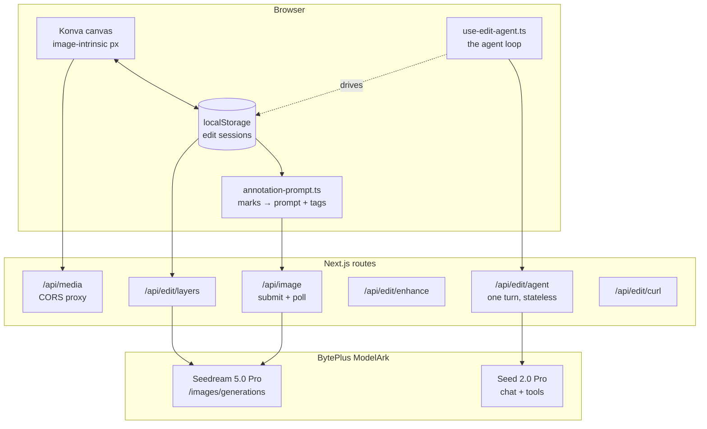
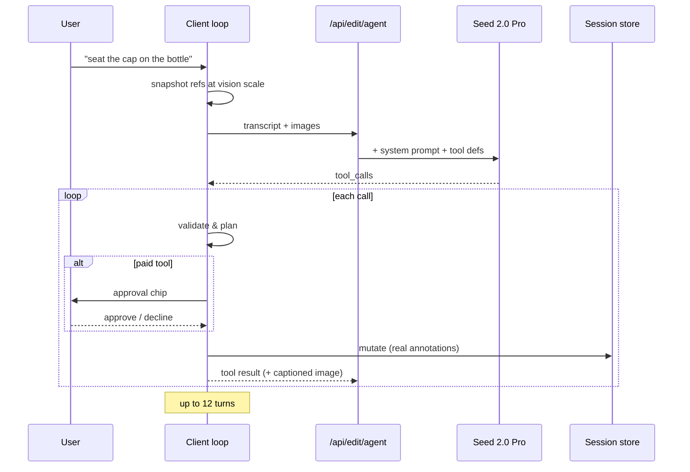

# Image Editor — Technical Implementation

How the interactive image editor in this codebase is built: an annotate-and-render
editor on top of Seedream 5.0 Pro, with an agent that drives the same tools a user
does.

This is an implementation reference, not a tutorial. It documents the decisions that
are load-bearing — the ones where the obvious approach produces a bug that looks like
a model failure rather than a code failure. Those are called out as **⚠ Invariants**.
Section 12 lists what is not solved.

**Companion document:** `docs/prd-image-editor.md` (product spec, capability areas,
sources). This document covers the build.

---

## 1. What it does

A user opens an image, marks it up (point / box / brush / arrow), types what should
change, and renders. Marked regions change; everything else is preserved. Each render
is a version they can compare and restore.

Alongside that sits an agent with access to the same operations as tools. It can read
the session, place marks, write the instruction, preview its own work, and request a
render — which pauses for the user's approval.

The core insight the whole design rests on: **Seedream accepts coordinates as text
tags in the prompt**. Points and boxes travel as `<point>` / `<bbox>` tags with the
image left pixel-clean. That gives exact spatial targeting with no mask, no inpainting
pipeline, and no second model.

---

## 2. Architecture



Two decisions shape everything else.

**The agent loop runs on the client.** The session lives in `localStorage`, so the
server cannot read or mutate it. A server-side loop would have to ship the entire
canvas state up and every mutation back on every turn, reimplementing the store across
the wire. Keeping the loop client-side means the canvas stays the single source of
truth, every tool call lands as a real annotation the user can drag or delete, and the
approval gate for paid tools sits in the same code that renders the UI.
`/api/edit/agent` is stateless: conversation in, one assistant turn out.

**The editor wraps `/api/image` rather than forking it.** That route already carries
BYOK key handling, 1:1 upstream status forwarding, the fal provider branch, and the
async job pattern. A parallel "edit" route would duplicate all of it and drift.

### Files

| Path | Role |
|---|---|
| `lib/edit/types.ts` | Every persisted type. No runtime code. |
| `lib/edit/coords.ts` | Stage ↔ image ↔ normalized transforms |
| `lib/edit/annotation-prompt.ts` | Marks → compiled prompt (the verified contract) |
| `lib/edit/composite.ts` | Canvas compositing, markup burn-in, grid overlay |
| `lib/edit/sessions.ts` | localStorage store + `useSyncExternalStore` façade |
| `lib/edit/size.ts` | Output sizing under the model's pixel ceiling |
| `lib/edit/same-origin.ts` | Canvas-taint avoidance |
| `lib/edit/use-edit-render.ts` | Render loop: compile → resolve images → submit |
| `lib/edit/use-edit-agent.ts` | The agent loop |
| `lib/edit/agent-tools.ts` | Tool definitions, validation, session description |
| `lib/edit/layers-normalize.ts` | Tolerant read of the layer-separation response |
| `app/edit/[id]/*` | Workspace UI |
| `app/api/edit/*` | agent, layers, enhance, curl |

---

## 3. Model configuration

| Purpose | Model | Override |
|---|---|---|
| Image editing / generation | `dola-seedream-5-0-pro-260628` (Seedream 5.0 Pro) | `BYTEPLUS_IMAGE_MODEL` |
| Agent + prompt enhance | `seed-2-0-pro-260328` (Seed 2.0 Pro) | `BYTEPLUS_EDIT_MODEL` |
| Base URL | `https://ark.ap-southeast.bytepluses.com/api/v3` | `BYTEPLUS_BASE_URL` |

Both run on BytePlus, so the app needs exactly one credential. In a BYOK product that
matters more than it sounds: the agent adds no new provider, no new Settings field, no
second key to explain.

**Model aliasing.** BytePlus accepts either a raw model ID or a console-provisioned
endpoint ID (`ep-2026…`), depending on the account. `BYTEPLUS_MODEL_ALIASES` maps
logical → endpoint at the network boundary, so UI dropdowns stay on stable logical IDs.

> **⚠ Invariant.** Callers must branch on the *pre-alias* model ID. `isSeedance2()` and
> friends cannot infer a family from an opaque `ep-…` string.

**Pixel ceilings** (measured from the API's own rejections, not the docs):

| Model | Ceiling |
|---|---|
| Seedream 5.0 Pro | 4,624,220 px (~2K) |
| Seedream 5.0 Lite | 3072 × 3072 |
| Seedream 4.5 | 4096 × 4096 |

---

## 4. Data model

One session per image being edited, in `localStorage` under a versioned, user-scoped
key.

```
EditSession
├── refs: EditReference[]        // base image + subject/style/sketch references
│   ├── width, height            // intrinsic px — the coordinate space
│   ├── url, mirrorUrl, safeUrl
│   └── annotations: Annotation[]
├── versions: EditVersion[]      // one per render, with its instruction
├── layerSets: LayerSet[]        // layer-separation results
├── instruction, model, aspectRatio, quality
└── view: {scale, x, y}          // camera, so reopening resumes
```

Annotations are a discriminated union on `kind`, split into two transport classes:

```ts
export const VECTOR_TOOLS = ["point", "box"] as const;   // → coordinate tags
export const RASTER_TOOLS = ["brush", "arrow"] as const; // → burned into the image
```

Compile-time code branches on these two lists, never on individual kinds. Adding a
fifth tool means assigning it to a class, not editing every switch.

> **⚠ Invariant — no bytes in localStorage.** The ~5 MB quota is shared with every
> other feature. Every image is a URL; data URIs exist only in flight, for the duration
> of one fetch. A single inlined 2K frame would blow the budget for the whole app.

**Write failures are visible.** `writeStore` returns a boolean and records
`lastWriteError`, surfaced as a persistent banner. Swallowing a quota error is
acceptable for a 2 KB record; for a mask someone spent five minutes painting it is
silent data loss.

**Hot-path rule.** An in-progress brush stroke never touches the store. Points
accumulate in a ref, the Konva line is mutated imperatively, and one write fires on
gesture end. Writing on `pointermove` would `JSON.stringify` a several-hundred-KB
session at 60 Hz.

---

## 5. Coordinates — the part that silently breaks

Three coordinate spaces exist. Confusing them produces marks that are consistently,
subtly offset, which reads as model imprecision rather than a bug.

| Space | Where |
|---|---|
| **Stage px** | Konva Stage, CSS pixels, includes zoom/pan |
| **Image-intrinsic px** | Everything persisted. The canonical space. |
| **Normalized 0–1000** | What Seedream receives |

> **⚠ Invariant — all stored geometry is image-intrinsic pixels.** The Konva stage
> carries the contain-fit *and* the user's zoom/pan on its own transform, so a shape's
> stored coordinates are independent of how the canvas is displayed. A shape drawn at
> 400 % zoom lands in exactly the same place after a window resize.

> **⚠ Invariant — the normalization order is fixed.** image px → divide by imgW/imgH →
> ×1000 → round → clamp. **Never from stage px.** Normalizing downstream of the zoom
> would mean the coordinates sent upstream changed when the user scrolled the wheel —
> the render drifting from the marks for reasons nothing in the UI could explain.

Two out-of-bounds primitives exist because a contain-fit leaves dead bands, and a click
there is a real click yielding a negative coordinate:

- `isInsideImage` — a **point** in a dead band is *rejected*. Silently clamping snaps a
  mark to an edge the user did not click, which reads as a bug.
- `clampToImage` — a **box** drag that leaves the image is *clamped*. The intent
  ("everything out to the edge") is unambiguous and refusing it would be the annoying
  behaviour.

Policy lives in the gesture handlers; the primitives just compute.

**Degenerate input never throws and never produces NaN.** A 0 × 0 stage is normal on
first mount, between render and the ResizeObserver firing. Every entry point falls back
to an identity transform. One wrong frame is invisible; a NaN coordinate propagates into
stored annotations, survives a JSON round-trip as `null`, and corrupts the session.

---

## 6. The prompt compiler

`compileAnnotationPrompt` turns a session into the string sent upstream. Pure and
fully tested — no I/O, no DOM.

Output for a representative session:

```
Remove the paper ball. Replace the tabletop with dark walnut.

Reference image 2 is a subject reference: composite the object it shows into the
scene, matching the perspective, lighting, shadow and scale of reference image 1.

Reference image 1 target notes: Mark 01 (point 1) — remove the logo on the sleeve;
Region 02 (box 1) — replace the surface with brushed steel.

Reference image 1 interactive targets (normalized 0-1000 coordinates):
<point>[[420,318],[512,640]]</point>
<bbox>[[120,200,480,760]]</bbox>
Apply the requested edit specifically to these marked targets. Preserve unmarked
regions unless the instruction explicitly says otherwise.
```

Structure, in order: instruction → role prose (once) → per-reference note lines →
target tag block → raster prose block.

> **⚠ Invariant — the tag block is byte-exact and frozen.** The header line, the
> `<point>`/`<bbox>` lines, and the trailing instruction sentence are lifted from
> BytePlus's own demo. A golden-string test asserts them character for character.
> **An ignored tag is indistinguishable from a bad edit in the response**, so there is
> no runtime signal that a reworded "improvement" broke targeting — only the test.
> `JSON.stringify` produces the tag arrays, because hand-rolled string building is
> exactly where a stray `", "` creeps in.

Rules worth copying:

- **An empty tag array is never emitted.** `<point>[]</point>` is untested input; the
  demo never produces it, and "probably ignored" is not a basis for shipping it on
  every box-only edit.
- **Degenerate boxes are demoted.** A box under 4/1000 on either axis after
  normalization is a line, not a region, and a likely model confuser. It becomes a
  point at its centre, with a warning.
- **Role prose exists because Seedream gets several images in one array with no
  inherent labelling.** Without it the model guesses which is the subject and which is
  a style hint, and guesses wrong often enough to turn a fusion into a collage.
- **Caps:** 20 targets per reference, 600 words of instruction. Both produce warnings
  rather than silent truncation.

### Raster marks

Brush and arrow have no tag equivalent anywhere in the contract, so they are burned
into a copy of the image in high-saturation magenta — a colour essentially absent from
natural photography, which is what makes *"do not reproduce the magenta markup in the
output"* a followable instruction. That sentence is appended automatically.

Arrow semantics are a closed enum (`move-to`, `look-toward`, `extend-along`,
`point-at`), each mapping to fixed wording. Consistency run to run is what makes an
arrow debuggable at all — if the phrasing drifted, a bad result would be
unattributable. **Mixed intents fall back to a generic sentence** rather than emitting
several competing instructions the model would have to choose between.

A `move-to` arrow whose tail sits inside a box gets explicitly paired wording — *"the
marked box at its tail is the subject to move, and the head is where it goes"* — so
the exact `<bbox>` names the subject and the arrow carries only direction. This is
all-or-nothing across the arrows on a reference, for the same reason mixed intents are.

---

## 7. The render path

Three stages, split so the first is pure:

```
buildEditRequest    session → prompt + per-ref transport plan   (pure, testable)
resolveWireImages   plan → the actual image[] payload           (async, DOM)
render              submit, patch the version, stage to Library (hook)
```

Each reference is sent either **clean** (vector marks only — the image is untouched)
or **composite** (raster marks present — markup burned in). One flag per reference,
decided by the compiler.

**The version record is written before the request goes out**, as `pending`, and
patched on settle. That ordering is what lets a render survive a refresh mid-flight:
the row is already in the store, so the workspace shows it as failed rather than losing
the instruction and compiled prompt that produced it.

### Output sizing

`sizeForEdit` is a total function: for any model and any source image it returns a
`"WxH"` the model will accept, asserted across the whole model registry in tests.

Three choices worth copying:

- **Default is "source", not a quality preset.** A preset puts its long side on the
  longer axis regardless of input, so a 1364 px image at "2k" comes back 2144 px — a
  1.6× upscale nobody asked for, *on every iteration*. Worse than cost: it resamples
  the whole image, so regions the user never marked take generation loss each round
  trip. For an edit the intuitive contract is same size out as in.
- **Never `"adaptive"`.** That is Seedream's own auto-sizer, which is not the same as
  "match the input". For an edit, aspect drift between input and output is a defect.
- **Round *down* to a multiple of 8.** Flooring can only reduce the pixel count, so it
  can never re-cross the ceiling just scaled under. Rounding to nearest reintroduces
  the exact bug this exists to prevent, on inputs sitting at the cap.

### Async submit + poll

Image generation is **synchronous upstream** — there is no task API, unlike video. A
slow model + size (Pro at 2048²) can exceed a load balancer's ~60 s response timeout,
which returns a 504 the app never sees because the request is still running.

So `POST /api/image` submits a background job and returns `{ jobId }` in under a
second; the client polls `GET /api/image/[id]`. The generation runs as a floating
promise in a long-lived Node process, so nothing holds an HTTP request open and no
gateway timeout can fire at any model or size.

```
POST /api/image        → { jobId }                      < 1 s
GET  /api/image/[id]   → { status: "running" }          poll @ 2 s, 6 min ceiling
                       → { status: "succeeded", data }
                       → 4xx/5xx { error }              upstream status forwarded 1:1
```

Jobs are user-scoped in memory with a 5-minute TTL. `lib/compare/request-image.ts`
wraps submit-then-poll and resolves a real `Response` with the original shape, so
callers keep their existing `res.ok` / `res.json()` handling.

**Trade-off, accepted:** a container restart mid-generation loses in-flight jobs; the
poll 404s and the user retries. Fine for a single container. Move to a DB table before
running multiple replicas.

---

## 8. Canvas tainting — the failure that hides until the end

Drawing a cross-origin image into a `<canvas>` **succeeds and looks completely
normal** — but the canvas is then tainted, and `toDataURL()` throws `SecurityError`.
The image renders, the user annotates it, and the export fails at the very end.

BytePlus CDN URLs send no `Access-Control-Allow-Origin`, so every generated asset hits
this. Resolution therefore happens **before the image is displayed**, not lazily at
composite time — by then the user has already done the work.

`resolveSafeUrl` returns `{ url, crossOrigin, via, shouldMirror }` where `via` is one
of `as-is | same-origin | mirror | proxy | direct-cors`. It is a pure function so it
can be tested; the side effect (kicking off a mirror) is the caller's business.

Two supporting mechanisms:

- **`/api/media`** streams a remote asset from our own origin, forwarding `Range` both
  ways so video scrubbing still works. Host-allowlisted so it cannot be used as an open
  bandwidth amplifier.
- **Mirroring** downloads the asset to local cache and rewrites the record to a
  same-origin path. This also outlives the signed URL: generated content sits behind a
  24 h `X-Amz-Expires` presigned URL, so an un-mirrored asset becomes permanently
  unreachable a day later.

> **⚠ Invariant.** `img.crossOrigin` must be set **before** `src`, or the attribute is
> ignored for the load already in flight and the canvas taints anyway.

---

## 9. Layer separation

Seedream 5.0 Pro can split an image into a background plate plus transparent element
layers, each with `z_index`, `bounding_box` (absolute and normalized), `name`, and
`description`.

This is a **preview feature, granted per account**, and the response shape is
documented as non-final. Both facts drive the design:

- `layers-normalize.ts` reads it tolerantly — `z_index` or `zIndex`, `bounding_box` or
  `boundingBox` or `bbox`, a structured box or a bare 4-array, numeric strings. It
  derives whichever coordinate space is missing from the source dimensions. **It never
  throws:** it runs after a paid call has already succeeded, so throwing would turn a
  partially-readable response into a 500 and lose the evidence.
- Unrecognised entries are echoed back verbatim as `unknown[]`, and every assumption
  produces a `warning`. When the shape drifts, the fix is a new row in the test table
  rather than an archaeology session.
- A key that renders fine may simply lack access. 403/404 is reported as *"not enabled
  for this key — it's a preview feature"*, not as a generic failure.

The route validates preconditions (exactly one image, no arrays, size limits) **before
spending the call**. Each check maps to a specific opaque BytePlus 400 that would
otherwise be handed back verbatim: `InvalidParameter` tells a user nothing, *"layer
separation takes a single image, but 3 were sent"* tells them what to do next.

---

## 10. The agent

### Loop shape



**Tool definitions come from the server, not the request body**, so a caller cannot
widen the agent's powers. The system prompt is prepended server-side for the same
reason.

### The 13 tools

| Tool | Notes |
|---|---|
| `inspect_session` | Dimensions, marks, versions, layer sets — all pre-scaled |
| `place_point` / `place_box` | Exact — become coordinate tags |
| `place_arrow` | Approximate — burned in and described in prose |
| `clear_annotations` | By id, or all |
| `set_instruction` | The sentence sent to the image model |
| `add_reference` | |
| `preview_prompt` | The compiled string, free |
| `preview_marks` | Its own marks drawn back over a labelled grid, free |
| `render` | **Costs money — approval gated** |
| `separate_layers` | **Costs money — approval gated** |
| `restore_version` | |
| `ask_user` | |

The agent hits the same caps a human does — 20 marks per reference, reported the same
way. It must not be able to route around a limit the UI enforces.

### Vision scaling

References are downscaled to a vision tier (long edge 2576 px) before attaching, and
**every coordinate the agent works in is that scaled space**. `inspect_session` reports
scaled dimensions; inbound coordinates are divided by the same factor in exactly one
place (`toIntrinsic`).

> **⚠ Invariant — derive the scale from the LONG EDGE, not the pixel count.** A
> 4000 × 1000 image is only 4 MP, so a pixel-count cap alone leaves its long edge at
> 4000 and blows the tier — and every returned coordinate is then scaled against a
> factor that was never applied.

Max 4 references attached (~4,800 input tokens each). Images are re-attached only when
the reference set's signature changes: re-sending the same pixels every turn re-bills
them, but "once, ever" was also wrong — swap the base image mid-conversation and the
model keeps answering about the picture it saw first.

### Grounding — the hard part

An LLM placing marks by eye is doing coordinate regression, which vision models are
weak at. Three mechanisms address it, in increasing order of reliability:

1. **`preview_marks`** renders the agent's own marks back to it over a labelled
   coordinate grid, with their current numeric geometry. Placing a mark and being told
   only "Added Region 01" gives the model no way to discover it landed 200 px off.
2. **Measured boxes.** `separate_layers` returns real detected bounding boxes. These
   are handed to the agent in *its* coordinate space and marked explicitly as measured
   rather than estimated — the only position in the loop that did not come from the
   model's eye. They are also re-reported by `inspect_session` so they outlive the turn
   that produced them.
3. **Escalation.** After a second miss the agent is told to stop estimating and offer
   layer separation instead of guessing a third time the same way.

> **⚠ Invariant — captions belong to the image that produced them.** Two very different
> pictures travel the same channel: a finished render, and the marked-up verification
> view. A single shared caption saying *"this is the render that just completed"*
> labelled the verification image as an output — so the agent judged its own magenta
> annotations as rendered pixels, and was told in the same breath to *describe* a fix
> rather than make one, contradicting the system prompt at the exact moment the image
> landed. No amount of prompt strengthening survives a caption that says otherwise.
> Each image carries its own caption and its own turn.

A second lesson in the same family: **the tool schema is guidance too.** The agent
reached for lone arrows on "move X to Y" requests because both the system prompt and
the `place_arrow` description framed the choice as either/or — positional → box,
directional → arrow. Neither ever said *both*. A move needs the box (which thing,
exactly) *and* the arrow (where to, approximately).

### Nothing ends in silence

Every path that stops the loop says why. Earlier versions returned silently on several
branches, leaving the panel unchanged — no reply, no error. That is what "the agent is
stuck" looks like from outside, and it is worth more words than it costs.

| Condition | Surface |
|---|---|
| `finish_reason: "length"` with a half-formed call | "…began N tool calls but ended early, so nothing was run" |
| Empty content, no calls | "…returned nothing to act on (reason)" |
| Session unreadable mid-turn | "Lost track of this session. Reload and try again." |
| Turn exceeds 120 s | "The model did not answer within 120s." |
| 12 turns elapsed | "Stopped after too many steps." |
| Missing key | 402 → "Add your BytePlus API key in Settings" |

**Output ceiling is 8192 tokens.** Tool schemas are long, and a model that narrates
before calling a tool can spend the whole budget on prose and truncate mid-call.
Output bills as used, so a high ceiling costs nothing on turns that don't need it.

---

## 11. Hangs, and why they are the worst bug class

A hang is indistinguishable from slowness, so it produces no error, no log line, and no
retry — just a spinner. Three were found and closed; the pattern generalises.

**`` with no timeout.** `onload` and `onerror` are the only exits from an image
promise, and a request hanging at the network layer fires *neither*. The agent's
snapshot step awaits image loads before its first turn, so a hung image meant `send()`
never reached its `finally`, `busy` was never cleared, and the panel showed "Thinking…"
forever. Now: 30 s ceiling, handlers detached, `src` dropped on timeout.

**A proxy with no timeout.** `/api/media` awaited an upstream that could accept the
connection and then say nothing, holding the route open indefinitely — which is what
made an image request stall in the first place.

> **⚠ Invariant.** Clear the timer when response **headers** arrive, not when the body
> finishes. `fetch` resolves on headers, so this bounds the part that can hang while
> leaving the body free to stream for minutes. A blanket timeout would cut off exactly
> the long video reads a media proxy exists to serve.

**An orphaned promise.** The approval gate parks on
`await new Promise(resolve => { approvalRef.current = resolve })`. Reset cleared the ref
*without calling it*, so starting a new chat mid-approval left the loop waiting on a
promise nothing could resolve. Reset now declines first, then clears.

The general rule: **every await that can hang needs a bound, and every bound needs a
message that says which bound fired.**

Related — an upstream error must never be dressed as a success. `/api/media` returning
a 403 through the success path gave it `cache-control: immutable, max-age=300`, so the
browser pinned the failure for five minutes; re-mirroring the asset changed nothing the
user could see. Errors now carry `no-store`.

---

## 12. Constraints and known gaps

### Limits

| Constraint | Value |
|---|---|
| Annotations per reference | 20 |
| Versions retained | 50 |
| Agent turns per request | 12 |
| References attached to the agent | 4 |
| Vision long edge | 2576 px |
| Agent turn timeout | 120 s |
| Image load timeout | 30 s |
| Media proxy header timeout | 20 s |
| Separated layers | 1–16 (default 10) |
| Instruction word cap | 600 |
| Input image | ≤ 10 MB, ≤ 6000 × 6000, aspect 1/16–16 |

### Not solved

Stated plainly, because a customer rebuilding this will hit them.

1. **First placement is still estimated.** Grounding improves *correction*, not the
   initial guess. Measured boxes require a paid, approval-gated, preview-flagged call.
   The complete fix is `place_box({ target: "cap" })` — the agent selects a detected
   object rather than typing coordinates, turning regression into selection. Not built.
2. **The agent loop has no test coverage.** `use-edit-agent.ts` has no test file, which
   is why the caption mismatch in §10 survived. Everything pure around it is well
   tested; the loop itself is not.
3. **Sessions are single-device.** localStorage means no cross-device continuity and a
   ~5 MB ceiling. IndexedDB is the migration path; the store API is already shaped for
   it.
4. **In-flight render jobs die with the container**, and the job store is per-process
   — a DB table is required before running multiple replicas.
5. **An output pixel *floor* is asserted in two places and enforced nowhere.** Seedream
   is documented as wanting ≥ ~3.7 MP output; `sizeForEdit` enforces only the ceiling.
   This needs one authoritative number from the API before either file can act on it.
6. **Extreme aspect ratios bottom out at a 128 px short side**, because the floor is on
   total pixels. A 512 px per-side minimum is documented and unchecked.
7. **The grid is labelled only on the top and left edges**, so reading a mid-frame
   coordinate means tracing a line across the whole image — the visual operation
   vision models are worst at.

---

## 13. Suggested build order

Each phase is independently demonstrable.

1. **Foundations** — coordinate transforms with their tests, the session store, the
   Konva canvas. Get §5 right before anything else; every later bug traces back here.
2. **Prompt-only editing** — instruction in, `/api/image` out, versions. No marks yet.
   Proves the model path end to end.
3. **Vector marks** — point and box, the compiled tag block, the golden-string test.
   This is the headline capability and it is a compiler, not a model integration.
4. **Raster marks** — brush and arrow, compositing, the magenta convention.
5. **Robustness** — same-origin resolution, mirroring, async submit+poll, timeouts.
   Unglamorous and load-bearing; §8 and §11 are both here.
6. **Agent** — tools over the operations already built. Because the tools are the same
   mutations the UI performs, this phase is mostly loop plumbing and prompt work.
7. **Layer separation** — last, since it is preview-gated and not every key has it.

The ordering that matters most: **the compiler before the agent.** The agent is worth
building only once a human can produce a good render by hand, because the agent's whole
job is to do what the human would have done.
