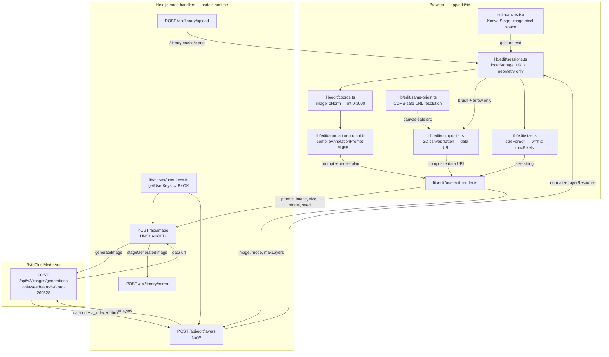
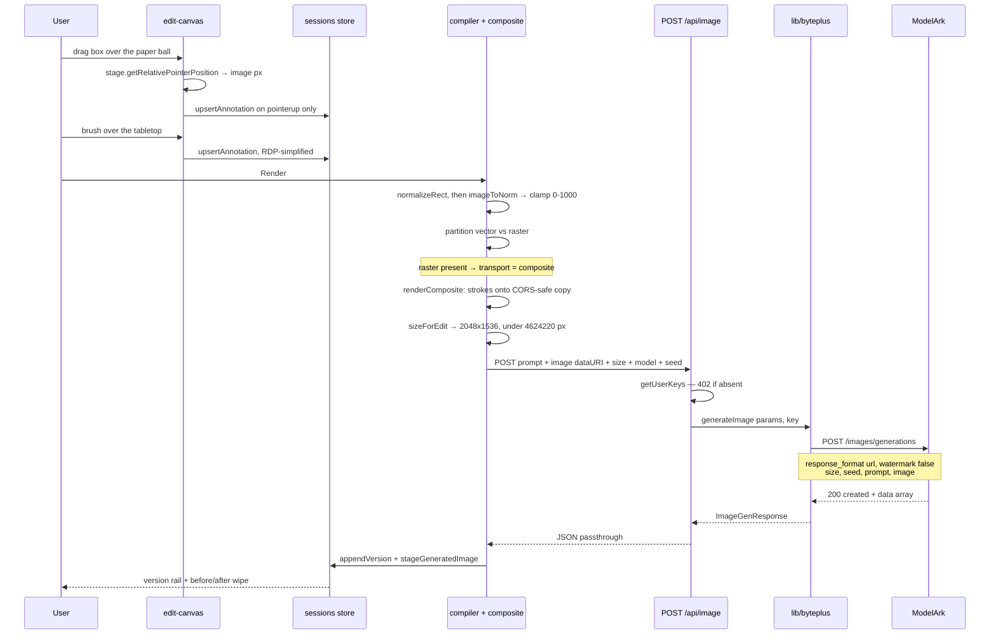
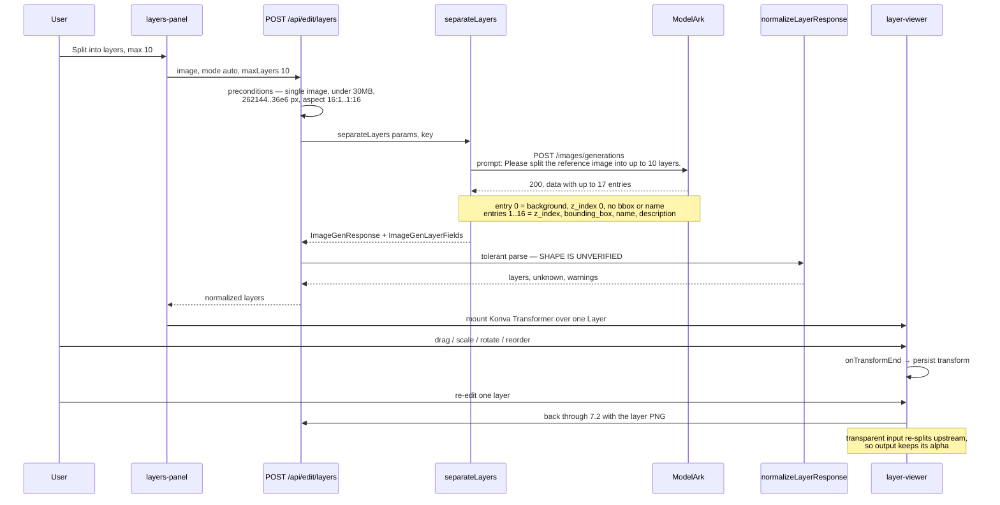
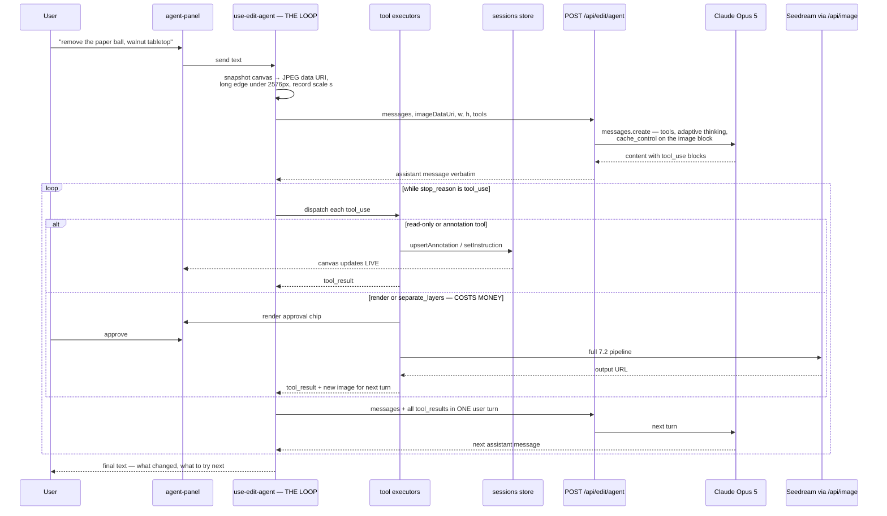

# PRD: Image Editing Tab — Seedream 5.0 Pro Interactive Editor

**Status:** Draft · **Owner:** Mittul Madaan · **Date:** 2026-08-02
**Target image model:** Seedream 5.0 Pro (`dola-seedream-5-0-pro-260628`)
**Target agent model:** Seed 2.0 Pro (`seed-2-0-pro-260328`, BytePlus ModelArk)

---

## 1. Summary

Add a fourth creative surface to Lumen Hub — **Edit** — a canvas-based image editor where a customer loads an image, marks it up with professional-editor tools (point, box, brush, arrow), describes the change in plain language, and gets back a precisely-scoped edit from Seedream 5.0 Pro.

On top of the canvas sits an **agent**: the user says *"remove the paper ball and make the table walnut"*, and Seed 2.0 Pro places the annotations, writes the Seedream prompt, runs the render, looks at the result, and iterates — using the exact same tool surface the human uses.

The editor doubles as the demo vehicle for Seedream 5.0 Pro's differentiating features: interactive region control, layer separation into transparent PNGs, multi-image fusion, sketch-to-image, exact colour/material response, and multilingual text rendering.

**One-line pitch:** *Draw it, say it, or just ask.*

## 2. Problem

**The product gap.** Lumen Hub generates images but cannot edit them. Every generated asset dead-ends — the "Edit" affordance in the Creations feed has been a disabled placeholder. A user who gets 90% of the way to the right image has to re-roll the whole prompt and lose everything they liked.

**The demo gap.** Seedream 5.0 Pro's headline capabilities are, in a literal sense, invisible in Lumen Hub. Interactive editing, layer separation, and fusion have no UI. A prospect evaluating the model through this product sees a text box — the same thing every competitor has.

**The skill gap.** Interactive editing is powerful but *fiddly*: it needs the right tool, the right region, and a prompt phrased the way the model expects. In a live demo that is exactly the friction that kills momentum. An agent that translates intent into correct tool calls is what makes the capability demoable by a salesperson rather than only by the person who built it.

**The competitive gap.** Editing-on-canvas is now table stakes. Being generation-only reads as an unfinished tool.

## 3. Goals & non-goals

### Goals

| # | Goal | How we know it worked |
|---|---|---|
| G1 | Scoped edits to a region without disturbing the rest | Point/box edits work on the four canonical Lumina examples |
| G2 | Every Seedream 5.0 Pro differentiator has a live surface | All capability areas in §5 reachable in ≤3 clicks from `/edit` |
| G3 | **A user can drive the editor by talking to it** | Agent completes each §5 capability from a single plain-language request |
| G4 | Editing is non-destructive and iterative | Version history; restore any version *with its annotations* |
| G5 | Edits flow into the rest of the product | Outputs auto-save to Library and the Creations feed |
| G6 | A salesperson can run the demo unassisted | Preset strip + agent handles the "what do I type?" problem |

### Non-goals (v1)

- **Not Photoshop.** No freeform compositing, masks-as-objects, blend modes, curves, or text layers. The canvas exists to *communicate intent to the model*.
- **No collaboration.** Single user, single device. Sessions are local.
- **No video.** Images only.
- **No autonomous spend.** The agent never runs a paid render without an explicit approval, unless the user turns auto-run on for the session.
- **No new billing/credits system.**
- **No mobile-optimised canvas.** Desktop-first.

## 4. Competitive context

| Product | Strength | Gap | Our angle |
|---|---|---|---|
| **ByteDance Lumina** (first-party) | Reference implementation: 4 annotation tools, chip-based prompt tokens, full-screen canvas | Consumer-oriented; transient state; no version history; **no agent** | Same tools, session-persistent, version-tracked, and drivable by an agent |
| **Magnific** (inside Freepik) | Best-in-class upscaling, Relight, Style Transfer; **Figma and Photoshop plugins** | Enhancement-oriented, not instruction-oriented | We're semantic, not pixel-enhancement. Their *plugin distribution* is the strategic lesson |
| **Higgsfield** | Video-first breadth, 70+ camera presets, mobile-first; "Popcorn" merges editing with storyboarding | Image editing is brush-a-region inpainting — no coordinate control, no layer decomposition | Preset strips are their best idea and we copy it. Depth on one model beats their breadth |

**Three conclusions.**

1. **Presets are the demo.** Both leaders lead with loaded examples, not empty canvases. Every capability ships with one.
2. **Layer separation has no equivalent anywhere** in the comparison set. Hardest to build (§10 R1), only feature with no competitive answer.
3. **Nobody in this set has an agent driving the editor.** Inpainting tools take a brush and a prompt; none takes an instruction and decides *which tool to use*. This is the genuinely novel surface.

## 5. Scope — capability areas

### 5A. Interactive annotation editing *(the headline)*

Four tools, split across two transports because the model's contract forces it:

| Tool | Interaction | Transport | Verified? |
|---|---|---|---|
| **Point** | Click to drop a target | `<point>[[x,y]]</point>` tag, clean image | ✅ From BytePlus demo JS |
| **Box** | Drag a rectangle | `<bbox>[[x1,y1,x2,y2]]</bbox>` tag, clean image | ✅ From BytePlus demo JS |
| **Brush** | Freehand stroke / colour block | Strokes flattened onto image + prose | ⚠️ Inferred from Lumina |
| **Arrow** | Drag source → destination | Arrow flattened onto image + prose | ⚠️ Inferred from Lumina |

Coordinates are integers, 0–1000, normalized against intrinsic dimensions. Caps: 20 targets/reference, 10 references, 600-word instruction — matching BytePlus's own limits.

Annotations get auto-labels (`Mark 01`, `Region 02`) and an optional per-mark note. A **"show compiled prompt"** disclosure reveals the exact string going upstream — non-negotiable, because when a demo misbehaves the first question is "what did it actually send?"

**Mixed-transport rule:** when a reference carries both kinds, send the composite *and* still emit the coordinate tags. The composite is pixel-identical outside the strokes, so the coordinates still address the same content.

**Marker colour** defaults to `#FF00E5` — effectively absent from natural photography. The raster prose must end with *"Do not reproduce the magenta markup in the output"*; without that line the model paints the scribbles into the result.

### 5B. Layer separation + layer viewer

Split an image into a background plate plus up to 16 transparent PNG layers, each carrying `z_index`, `bounding_box` (absolute + 0–1000 normalized), a model-generated `name`, and a `description`.

The viewer — modelled on `seed-demo.bytedance.net/layer-viewer` — allows drag-to-reposition, corner-scale, z-reorder, visibility toggle, per-layer re-edit through the 5A path, and export of the recomposition.

Two spec behaviours shape the UI: editing a transparent layer triggers an automatic re-split so output **retains alpha**; and the feature is **flagged upstream and documented as non-final**, so it ships behind `NEXT_PUBLIC_EDIT_LAYERS` and degrades gracefully when a BYOK key lacks access.

### 5C. Multi-image fusion + sketch-to-image

Up to 10 references with per-reference **roles** — `base`, `subject`, `style`, `sketch` — where the role generates the prose telling the model how to use each one. Technically the cheapest area: `ImageGenParams.image` is already `string | string[]`.

### 5D. Colour/material control + multilingual text

Hex swatch picker injecting exact colour codes, a material preset list (brushed steel, dark walnut, frosted glass…), and a text-rendering demo strip covering 10+ languages. Pure data and copy.

### 5E. Agentic editing *(the differentiator)*

A chat panel beside the canvas. The user states intent; Seed 2.0 Pro drives the editor through the **same tool surface the UI uses**, and every action it takes is visible as a real annotation on the canvas — not a hidden side channel.

```
User:  "remove the crumpled paper on the left and make the table dark walnut"

Agent: inspect_session()                          → 1 ref, 1024×768, 0 marks
       place_box({ x:112, y:186, w:140, h:96,
                   label:"Region 01",
                   note:"remove the crumpled paper ball" })
       place_box({ x:0, y:520, w:1024, h:248,
                   label:"Region 02",
                   note:"dark walnut wood, keep lighting" })
       set_instruction("Remove the paper ball in Region 01. Replace the
                        tabletop in Region 02 with smooth dark walnut,
                        maintaining the original lighting and shadows.")
       render()                                   → ⏸ awaits approval
       ...
       → sees the output, reports: "Paper gone, walnut applied. The candle's
         shadow didn't update — want me to fix just the shadow?"
```

**Why this is the right shape:** the model's own weakness is prompt phrasing and region selection, and both are things Claude is good at. The agent is not a wrapper around the prompt box — it is a *driver of the tools*, which is why the canvas stays the source of truth and every agent action remains inspectable, undoable, and editable by hand.

Full tool surface, loop placement, and cost model in §8.

## 6. User experience

### Entry points

1. **Nav** → `Edit` at `/edit` (a dashboard of saved sessions, mirroring `/story`).
2. **Creations feed** → the Pencil pill on any image asset creates a session seeded with that image. This replaces the existing disabled placeholder.
3. **Library** → "Edit" action on an image asset.

`Edit`/`/edit` is chosen because `Canvas`/`/studio` is the node graph and `/generate` is the Generator.

### The workspace (`/edit/[id]`)

```
┌──────────────────────────────────────────────────────────────────────┐
│ SiteHeader                                                           │
├──────────┬──────────────────────────────────┬───────────────────────┤
│ TOOLS    │                                  │  AGENT          ⏻ auto│
│  ▸ Point │                                  │  ┌──────────────────┐ │
│  ▸ Box   │        KONVA CANVAS              │  │ you: remove the  │ │
│  ▸ Brush │   (pan / zoom / annotate)        │  │ paper ball…      │ │
│  ▸ Arrow │                                  │  │                  │ │
│  ▸ Pan   │                                  │  │ ▸ place_box      │ │
│          │                                  │  │ ▸ render  [✓][✗] │ │
│ LAYERS   │                                  │  └──────────────────┘ │
│  (5B)    │                                  │  MARKS · REFS · VERS  │
├──────────┴──────────────────────────────────┴───────────────────────┤
│ PRESETS: Recolor · Remove · Fuse · Sketch→img · Split layers          │
│ [ instruction ────────────────── ] model ▾ aspect ▾ 2K ▾  [ Render ]  │
│  ▸ show compiled prompt                                              │
└──────────────────────────────────────────────────────────────────────┘
```

### Core loops

**Manual:** load → pick tool → mark → type instruction → Render → compare with wipe slider → accept / iterate / branch.

**Agentic:** load → describe the change → watch tool calls land as real annotations → approve the render → agent reports and offers the next step.

The two are the same loop. The agent's marks are ordinary annotations the user can drag, delete, or add to; the user's marks are visible to the agent on its next turn. Neither mode is a separate document.

Every render appends a version capturing the instruction, the *compiled* prompt, model, size, seed, and an annotation snapshot — so restoring v2 restores the marks that produced it.

## 7. Low-level architecture — Seedream 5.0 Pro integration

### 7.1 Request path



The load-bearing property: **`/api/image` is unchanged.** Everything specific to editing — compilation, compositing, sizing, CORS resolution — happens client-side before the fetch, so the route keeps its existing BYOK, 402 mapping, 1:1 status forwarding, and fal branch with no new conditionals.

### 7.2 Sequence — an annotated region edit



**The prompt on the wire** — vector suffix byte-identical to BytePlus's own demo, raster prose appended after it:

```
Remove the paper ball. Replace the tabletop with dark walnut.

Reference image 1 target notes: Region 01 (box 1) — remove the crumpled paper ball.

Reference image 1 interactive targets (normalized 0-1000 coordinates):
<bbox>[[109,242,246,367]]</bbox>
Apply the requested edit specifically to these marked targets. Preserve unmarked
regions unless the instruction explicitly says otherwise.

Reference image 1 contains hand-drawn markup: 1 painted mask area in magenta.
Apply the requested edit to the painted areas. Do not reproduce the magenta
markup in the output.
```

### 7.3 Sequence — layer separation



### 7.4 What is and is not on the wire

| Concern | Where it lives | Why |
|---|---|---|
| Annotation → coordinate tags | Client, pure fn | No API parameter exists; it's prompt text |
| Brush/arrow → pixels | Client, 2D canvas | Nothing else can flatten strokes |
| CORS-safe image resolution | Client, before display | `toDataURL()` throws on a tainted canvas |
| Output size clamp | Client, `sizeForEdit` | 5.0 Pro's 4,624,220 px ceiling; §10 R3 |
| BYOK key | Server only | Never leaves `getUserKeys()` |
| Model alias → `ep-…` | `resolveModel` in `lib/byteplus.ts` | Existing network-boundary indirection |
| Layer-shape tolerance | `normalizeLayerResponse`, one place | Upstream spec is preview/non-final |

## 8. Low-level architecture — the agent

### 8.1 Where the loop runs, and why

**The loop is client-driven; the server route is stateless and single-turn.**

The session lives in localStorage, so the server cannot read or mutate it. A server-side loop would need the entire canvas state shipped up and every mutation shipped back on each turn — reimplementing the store across the wire. Instead the client owns the loop and the server owns only the model call:



Consequences of this shape, all of them wanted:

- **The canvas is the agent's memory.** No parallel state to drift.
- **Every agent action is a normal annotation** — draggable, deletable, undoable.
- **Approval gates are trivially placed**, because the harness executing the tool is the same code that renders the UI.
- **No SSE required.** Turn-level granularity is enough; the tool-call chips are the progress indicator. This matters — it would otherwise be the first streaming route in the codebase.
- **BYOK stays server-side** for both providers.

### 8.2 Tool surface

Modelled on the guidance that hard-to-reverse actions deserve dedicated tools so the harness can gate them. Read-only and annotation tools auto-execute; the two paid tools do not.

| Tool | Input schema (abridged) | Effect | Gate |
|---|---|---|---|
| `inspect_session` | `{}` | Refs with intrinsic dims, current annotations, roles, instruction, versions, model/size | auto |
| `place_point` | `{refId, x, y, label?, note?}` | Adds a `PointAnnotation` | auto |
| `place_box` | `{refId, x, y, w, h, label?, note?}` | Adds a `BoxAnnotation` | auto |
| `place_arrow` | `{refId, fromX, fromY, toX, toY, intent}` | Adds an `ArrowAnnotation` | auto |
| `clear_annotations` | `{refId, ids?}` | Removes marks | auto |
| `set_instruction` | `{text}` | Sets the prompt box | auto |
| `add_reference` | `{assetId \| url, role}` | Adds a ref slot | auto |
| `preview_prompt` | `{}` | Returns the compiled string without sending | auto |
| **`render`** | `{model?, aspect?, quality?, seed?}` | Full §7.2 pipeline | **approval** |
| **`separate_layers`** | `{refId, mode, maxLayers?}` | §7.3 | **approval** |
| `restore_version` | `{versionId}` | Restores pixels + marks | auto |
| `ask_user` | `{question, options?}` | Blocks for an answer | n/a |

`place_*` coordinates are **image pixels in the space of the image the model was shown**, not normalized. Normalization to 0–1000 stays in `coords.ts`, exactly as for a human-drawn mark — one code path, one set of tests.

**The coordinate-scaling detail that will bite if missed.** Claude Opus 5 returns coordinates that map 1:1 to the pixels of the image it received. If the canvas snapshot was downscaled to fit the 2576px long-edge tier, every returned coordinate must be multiplied by `1/s` before it enters the store. The system prompt states the dimensions the model is looking at; the executor applies `s`. Getting this wrong produces marks that are subtly, consistently offset — the worst possible failure mode, because it looks like model imprecision rather than a bug.

### 8.3 Model configuration

```ts
// app/api/edit/agent/route.ts — one turn, no loop, no streaming
const result = await chatWithTools(
  {
    messages: [{ role: "system", content: SYSTEM }, ...body.messages],
    tools: toOpenAIToolDefs(),   // stable order
    maxTokens: 4096,
  },
  keys.byteplus,                 // already a REQUIRED provider
);
```

| Choice | Value | Rationale |
|---|---|---|
| Model | `seed-2-0-pro-260328` | Vision-capable and already the app's prompt model. Decisive factor: BytePlus is **already a required BYOK provider**, so the agent needs no new credential, no new Settings field, and no second vendor in a product built around BytePlus models. Also far cheaper per turn than a frontier model |
| Endpoint | `/chat/completions` | Tool calling is documented against it, and the `tool_calls` / `role:"tool"` round trip is the shape every OpenAI-compatible client speaks. Note `shouldUseResponsesApi` routes this model to `/responses` for prompt writing — the agent deliberately does not follow that |
| Streaming | none | Turn-level UI; avoids the codebase's first SSE route |
| Tool loop | client-side, manual | The client owns the state |
| Tool defs | one list, converted | Authored in the flatter Anthropic shape and converted by `toOpenAIToolDefs()`. Two hand-maintained lists drift, and a tool present in one but not the other either can't be called or is called and doesn't exist |

**Provider portability was designed in, not retrofitted.** `agent-tools.ts` — the schemas plus the coordinate-rescale logic, which is the expensive and correctness-critical part — has no provider import at all. Swapping models touches the route's wire format and nothing else.

### 8.4 Grounding the agent

The repo already has the mechanism: `claude_skill/` + `lib/server/seedance-skill.ts`, whose `buildGroundedSystem` returns `Anthropic.TextBlockParam[]` with `cache_control: {type:"ephemeral"}` on the core-docs block. That is the only prompt-caching usage in the codebase today and it is exactly the right shape here.

Add a sibling `claude_skill/seedream.md` + `references/` covering: the four annotation tools and when each applies; the `<point>`/`<bbox>` contract; the marker-colour convention; prompt phrasing for region edits ("keep X, Y, Z completely unchanged"); layer-separation prompt templates; and the colour/material vocabulary.

**Deployment gotcha with teeth:** `next.config.ts` lines 27–34 list `outputFileTracingIncludes` for the five routes that read skill docs. **A new route that reads them and isn't added to that list will silently ship without its docs** — degrading to the embedded fallback with no error. Add `app/api/edit/agent/route.ts` there.

### 8.5 Credentials — nothing new required

The agent authenticates with `keys.byteplus`, which every user must already have saved: it is in `REQUIRED_PROVIDERS` and the onboarding gate blocks the app without it. No new provider, no new Settings field, no migration — `user_api_keys.provider` is plain `TEXT` with no CHECK constraint, but nothing needs to be added to it either.

An earlier draft of this PRD specified Claude Opus 5 and the BYOK plumbing to support it. That work was written and then reverted when the provider changed. Worth recording why the reversal was cheap: the agent's tool surface carries no provider dependency, so only the route's wire format moved.

Separately, and still true: the two existing Claude routes (`optimize-prompt`, `article-to-prompt`) take their key from the browser POST body via localStorage rather than the encrypted store. That predates this table and should migrate; new code must not extend the pattern.

## 9. Phasing

| Phase | Scope | Size | Demoable alone? |
|---|---|---|---|
| **P0** | Routes, nav, session store, base-image upload, prompt-only editing, Creations-feed entry | S (~1d) | Yes — already beats the disabled pill |
| **P1** | **Konva canvas, point + box, compiler, render loop** | M (~2–3d) | **Yes — the headline demo** |
| **P2** | Brush + arrow, compositing, marker prose | M (~2d) | Yes |
| **P3** | Versions, restore/branch, before-after wipe, quota banner | S (~1d) | Yes |
| **P4** | **Agent: BYOK, tool surface, client loop, approval gates, skill docs** | **L (~3–4d)** | **Yes — the differentiator** |
| **P5** | Multi-ref fusion, sketch role, colour/material + text presets | M (~2d) | Yes |
| **P6** | Layer separation + viewer, feature-flagged | L (~3–4d) | Yes |

Roughly 14–17 engineering days.

**P4 sits after P3 deliberately.** The agent's tools *are* the manual tools; building it before the tool surface is stable means building against a moving target. Once P1–P3 land, P4 is mostly schema + loop + prompt — the expensive part (coordinates, compilation, rendering) is already written and tested.

## 10. Risks

| # | Risk | Sev | Mitigation |
|---|---|---|---|
| **R1** | **Layer-separation response shape is unverified and marked non-final** | High | One tolerant parser with an exhaustive test table; route echoes unrecognised entries so drift is diagnosable from the network tab; feature flag. **Open:** is the upstream flag account-scoped? Under BYOK it may work for one key and 402 for another — needs a graceful path before P6 is scoped |
| **R2** | **`<point>`/`<bbox>` tags are reverse-engineered.** An ignored tag is indistinguishable from a bad edit in the response | High | Byte-identical suffix locked by a golden-string test; compiled-prompt disclosure. **Recommendation: hard-pin point/box to 5.0 Pro**, falling back to brush/arrow (pixel-based, model-agnostic) elsewhere |
| **R3** | **Output size ceilings already conflict.** `pickImageSize({16:9},"2k")` = 5,308,416 px vs 5.0 Pro's 4,624,220 — the existing 2K-widescreen preset is *already* rejected on the default model | High | Edit uses `sizeForEdit`, unit-tested across every model × aspect asserting `isSizeAllowed`. *Pre-existing bug the Edit tab surfaces — worth a separate fix in `/generate`* |
| **R4** | **`usesAdaptiveThinking()` doesn't match `claude-opus-5`** — the regex in `app/api/optimize-prompt/route.ts` covers `opus-4-(6\|7\|8)` only, so Opus 5 falls to the `budget_tokens` branch, **which 400s** | High | The Edit agent route must not copy that helper. Fix the regex in both existing routes as part of P4 |
| **R5** | **Agent coordinate drift.** If the canvas snapshot is downscaled and `1/s` isn't applied, every mark is consistently offset — reads as model imprecision, not a bug | High | `s` is computed and applied in one executor; round-trip property test on a downscaled fixture; a visible "agent placed this" badge so offsets are noticed in QA |
| **R6** | **Agent cost.** ~4,800 image tokens/turn plus tool schemas; an uncached 10-turn session is expensive | Med | Cache breakpoint on tools+system and on the image block; stable tool ordering; nothing volatile in the prefix; re-snapshot only after the canvas changes. Verify with `usage.cache_read_input_tokens` — if it's 0 across turns, something is invalidating silently |
| **R7** | **Agent coordinate grounding is unverified.** This is the whole job — the agent's value is boxing *the right thing*. Claude Opus 5 documents a 1:1 pixel-coordinate guarantee; there is no equivalent published guarantee for Seed 2.0 Pro, and ModelArk's "visual grounding" claim is not a measurement | **High** | A scored probe exists (`scratchpad/seed-probe.mjs`): synthetic image, known ground-truth box, reports IoU and centre error. **Run it before demoing.** If grounding is poor the fallback is a provider swap, which touches only the route's wire format. Note the failure mode reads as *Seedream* being imprecise, not as an agent bug |
| **R7b** | Agent expands scope or over-narrates | Med | Scope-discipline and brevity instructions are in the system prompt; the approval gate on `render` is the hard backstop against expensive over-reach |
| **R8** | localStorage quota (~5MB, already shared) | Med | URLs only; RDP stroke simplification; caps of 20 annotations/ref and 50 versions; visible quota banner. IndexedDB deferred — `getSnapshot` must be synchronous |
| **R9** | `public/library-cache/` writes don't work on serverless | Med | Pre-existing, but Edit makes it *load-bearing* — the canvas cannot function on a tainted image |
| **R10** | react-konva ↔ React 19.2 peer range | Med | Verify at install; `--legacy-peer-deps` is not acceptable. Fallback: `konva` has no React peer and can be driven imperatively — ~150 extra lines |
| **R11** | Konva (~150KB gz) leaking into other bundles | Low | Dynamic boundary + `import type` discipline, enforced by a grep guard test |
| **R12** | Brush/arrow semantics are prose-only and unverifiable | Low | Constrain arrows to an `intent` enum; set expectations in UI copy |

## 11. Success metrics

- **Activation:** ≥40% of users who generate an image start an edit session in the same visit.
- **Agent adoption:** ≥50% of edit sessions use the agent for at least one turn — the signal that it's easier than the manual path, not just present.
- **Agent efficiency:** median ≤3 agent turns to an approved render.
- **Iteration depth:** median ≥3 versions per session.
- **Scoped-edit success:** ≥70% of point/box edits accepted without an immediate re-roll.
- **Cache health:** `cache_read_input_tokens > 0` on ≥90% of non-first agent turns.
- **Demo coverage:** all capability areas exercised in the first customer demo without falling back to a slide.
- **Zero regressions** in `/generate` and `/studio` — enforced by the reuse-not-fork rule on `/api/image`.

## 12. Engineering appendix

### 12.1 The verified annotation contract

From `seedream5.byteplus-demo.com/editor/editor.js`. Blocks joined by `\n\n`, appended after the user instruction:

```
Reference image 1 interactive targets (normalized 0-1000 coordinates):
<point>[[420,318],[512,640]]</point>
<bbox>[[120,200,480,760]]</bbox>
Apply the requested edit specifically to these marked targets. Preserve unmarked regions unless the instruction explicitly says otherwise.
```

Rules: integers only, `clamp(round(v),0,1000)`; omit a tag line entirely when its array is empty (**never `<point>[]</point>`**); normalize rects so `x1≤x2, y1≤y2`; demote a box narrower than 4/1000 on either axis to a centre point with a warning; refs with no annotations produce no block. Locked by a golden-string test — this is the one empirically verified artifact in the feature.

Labels/notes have **no verified tag**, so they emit as a prose line *before* the coordinate block, and only when at least one note is non-empty. With no notes, output is byte-identical to BytePlus's own. That gating is the point.

### 12.2 Files

**Logic** (under `lib/edit/`, where Vitest can reach it — `include` is `lib/**` only):

`types.ts` · `sessions.ts`+test · `use-edit-session.ts` · `coords.ts`+test · `annotation-prompt.ts`+test · `geometry.ts`+test · `composite.ts` · `same-origin.ts`+test · `size.ts`+test · `layers-normalize.ts`+test · `use-edit-render.ts`+test · `presets.ts` · **`agent-tools.ts`+test** (schemas + pure arg→mutation mapping) · **`use-edit-agent.ts`+test** (the loop, `renderHook` + stubbed fetch) · **`agent-coords.ts`+test** (the `1/s` rescale)

**UI** (`app/edit/`): `page.tsx`, `edit-dashboard.tsx`, `new-edit-modal.tsx`, `[id]/page.tsx`, `[id]/edit-workspace.tsx`, `[id]/canvas-loader.tsx`, `[id]/edit-canvas.tsx`, `[id]/tool-rail.tsx`, `[id]/annotation-panel.tsx`, `[id]/references-panel.tsx`, `[id]/prompt-bar.tsx`, `[id]/versions-rail.tsx`, `[id]/layers-panel.tsx`, `[id]/layer-viewer.tsx`, `[id]/preset-strip.tsx`, **`[id]/agent-panel.tsx`**, **`[id]/tool-call-chip.tsx`**

**API:** `app/api/edit/layers/route.ts`, **`app/api/edit/agent/route.ts`**

**Skill docs:** `claude_skill/seedream.md` + `claude_skill/references/*.md`

**Modified:** `components/site-header.tsx` (nav) · `components/generate/creation-row.tsx` (activate the pill) · `lib/byteplus.ts` (additive optional fields + `separateLayers`) · `lib/server/user-keys.ts` + `app/settings/page.tsx` (Anthropic BYOK) · `next.config.ts` (`outputFileTracingIncludes`) · `app/api/library/upload/route.ts` (allow bmp/tiff) · `package.json`

### 12.3 Reuse map

| Need | Existing thing |
|---|---|
| Session store shape | `lib/story/stories.ts` |
| localStorage user scoping | `userKey()` — `lib/storage-user.ts` |
| Generation | `POST /api/image` — **unchanged** |
| Render hook discipline | `lib/compare/use-image-render.ts` — *wrap, don't fork* |
| Error classification | `classifyError` — `lib/compare/error-class.ts` |
| Models, ceilings, clamps | `lib/studio/models.ts` |
| Saving outputs | `stageGeneratedImage` — `lib/library/auto-save.ts` |
| CDN → canvas-safe URL | `mirrorAsset`, `isByteplusHost`, `mediaProxyUrl` |
| Local file → URL | `POST /api/library/upload` |
| Client-only canvas boundary | `app/studio/studio-canvas-loader.tsx` |
| Modal chrome | `app/studio/folder-picker-modal.tsx` (no Radix dialog installed) |
| **Anthropic call shape** | `app/api/optimize-prompt/route.ts` — *the shape, not the key handling or `thinkingParams`* |
| **Grounded + cached system prompt** | `buildGroundedSystem` — `lib/server/seedance-skill.ts` |
| **Tolerant JSON parsing** | `parseVideoStyleVisionAnalysis` — `lib/studio/video-style.ts`, the three-tier `extractJsonObject` → `JSON.parse` → `jsonrepair` fallback |

**Deliberate non-reuse:** `ReferenceImageInput` for the *base* image (10MB cap, base64-in-state, while the base can be 30MB and must be a same-origin URL) — secondary refs only, and don't retrofit it since three call sites depend on its data-URI contract. Also not reused: `@xyflow/react` for the layer viewer (no rotation, no aspect-locked scaling, DOM not raster), `MediaTile` inside the Stage (nothing DOM works there), and `thinkingParams()` from the existing Claude routes (see R4).

### 12.4 Konva boundary

```
app/edit/[id]/page.tsx          Server. `const { id } = await params` (Next 16).
 └ edit-workspace.tsx           "use client". MUST NOT import react-konva.
    └ canvas-loader.tsx         "use client". dynamic(import, {ssr:false}).
       └ edit-canvas.tsx        "use client". The ONLY react-konva importer.
```

`konva` resolves a Node entry that `require("canvas")`, which isn't installed — a `"use client"` module still compiles on the server, so without this boundary the build breaks. Konva types must be `import type` or the boundary is silently defeated.

Three Konva `<Layer>`s maximum: base image (`listening={false}`), interactive annotations, HUD (`listening={false}`). In the layer viewer, all 17 separated elements go in *one* Konva layer ordered by `zIndex` — not one layer each.

Hot-path rule: an in-progress brush stroke never enters React state. Accumulate points in a ref, mutate the line imperatively with `batchDraw()`, `setState` once on `pointerup`, persist on gesture end only.

### 12.5 Extending `ImageGenResponse`

Purely additive optional fields in `lib/byteplus.ts` — adding optional properties is source-compatible, so `use-image-render.ts`, `image-generator.tsx`, and `image-gen-node.tsx` compile unchanged:

```ts
export type ImageGenLayerFields = {
  z_index?: number;
  bounding_box?: {
    absolute?: [number, number, number, number];
    normalized?: [number, number, number, number];
  };
  name?: string;
  description?: string;
};

export type ImageGenDatum = { url?: string; b64_json?: string; size?: string }
  & ImageGenLayerFields;
```

No separate response type and no second `request()` path — same endpoint, different prompt; a fork would duplicate `resolveModel`, auth, and `BytePlusError` handling. All tolerance lives in `normalizeLayerResponse`, whose test table must cover: the documented shape; camelCase vs snake_case; `bounding_box` as a bare 4-array; absolute-only and normalized-only (derive the other from source dims); missing `z_index` → array index; background detected both by `z_index === 0` *and* by "no bbox, no name, full-canvas size"; more than 17 entries; exactly 1 entry (nothing to separate — say so, don't show an empty viewer); `b64_json` instead of `url`.

### 12.6 Constraints reference

| | |
|---|---|
| Prompt | ≤600 words |
| References | ≤10 |
| Targets per reference | ≤20 |
| Coordinates | integers 0–1000 |
| Input formats | png, jpeg, webp, bmp, tiff, gif |
| Input size | ≤30 MB (layer separation); ~10 MB per BytePlus ref guidance |
| Input pixels | 262,144 – 36,000,000 |
| Input aspect | 16:1 – 1:16 |
| Layer output | 1 background + ≤16 layers |
| 5.0 Pro output ceiling | 4,624,220 px |
| Agent vision input | ≤2576 px long edge, ~4,784 tokens/image |
| Agent context | 1M tokens; cache minimum 512 tokens |

### 12.7 Sources

- BytePlus interactive editor demo — `https://seedream5.byteplus-demo.com/editor/` (contract read from `editor.js`)
- Layer viewer demo — `https://seed-demo.bytedance.net/layer-viewer/`
- *Lumina × Seedream 5.0 Pro — Interactive Editing* (product deck, four annotation tools)
- *Seedream 5.0 Pro Layer Separation Feature* (temporary preview — **marked non-final**)
- [Seedream 5.0 Pro Interactive Editing: 6 Ways to Control AI Art](https://www.atlascloud.ai/blog/ai-updates/seedream-5-0-pro-interactive-editing)
- [BytePlus ModelArk — Seedream 5.0 Pro tutorial](https://docs.byteplus.com/en/docs/ModelArk/2582774)
- [Higgsfield — AI Image Editing](https://higgsfield.ai/image-editing) · [Magnific review 2026](https://www.theworkflowfinder.com/tools/magnific)
