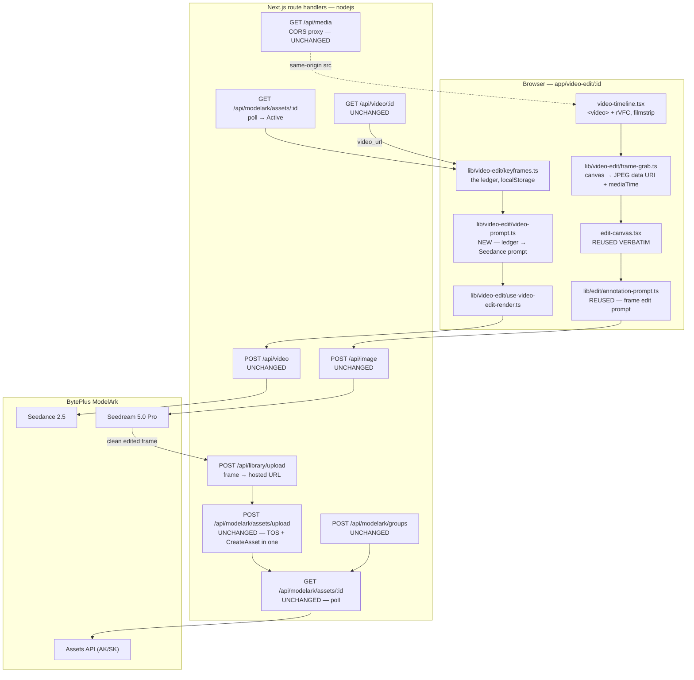
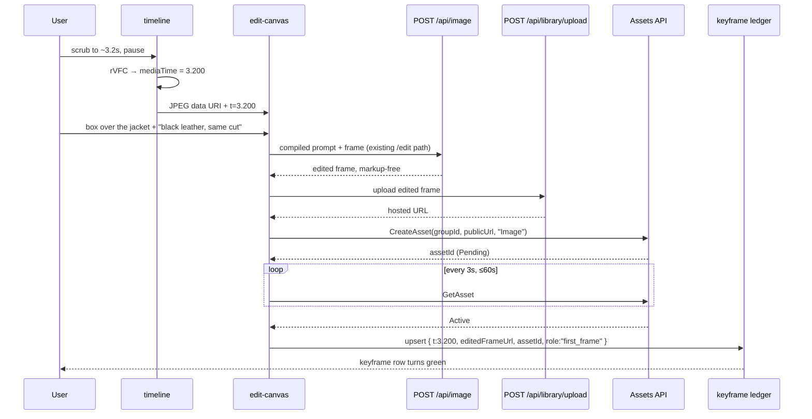
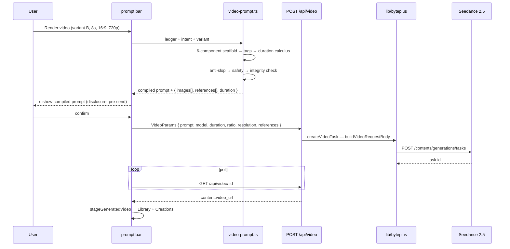

# PRD: Smart Video Edit — Keyframe Annotation → Seedance 2.5

**Status:** Draft · **Owner:** Mittul Madaan · **Date:** 2026-08-13
**Branch:** `feat/smart-video-edit`
**Target video model:** Seedance 2.5 (model id TBD — see §11 R1)
**Target frame-edit model:** Seedream 5.0 Pro (`dola-seedream-5-0-pro-260628`) — already shipped
**Target agent model:** Seed 2.0 Pro (`seed-2-0-pro-260328`)
**Companion docs:** `docs/prd-image-editor.md` · `docs/edit-implementation.md` · `claude_skill/`

---

## 1. Summary

Add a fifth creative surface — **Video Edit** — that does for video what the Edit tab did for
images: a customer uploads a clip, scrubs to a moment, marks up **that frame** with the same
professional-editor tools (point, box, brush, arrow, **text**), describes the change in plain
language, and gets back a regenerated video where the change is real and in motion.

The pipeline has one non-obvious shape, and it is the whole design:

> **You do not send markup to a video model. You send a *finished frame*.**

Annotations are compiled into an image edit, rendered by the already-shipped Seedream 5.0 Pro
editor, and the *clean* result — plus its exact timestamp — becomes a **keyframe** for Seedance
2.5. The marks never reach the video model; the model sees a still that already looks like the
answer, and is asked to move.

Every keyframe is auto-registered in the BytePlus **asset library** before submission, which is
what makes edits containing real or virtual human faces work at all (§9).

**One-line pitch:** *Pause it, draw on it, and the video changes.*

## 2. Problem

**The product gap.** Lumen Hub generates video and edits images, and the two never meet. A clip
that is 90% right is a dead end: the only fix is re-rolling a text prompt and losing everything
that already worked. There is no path from "this one shot has the wrong jacket" to a corrected
clip.

**The frame gap.** The one bridge that exists — `frame-extract-node` in Studio — extracts a frame
and stops. It has no editor, no timestamp ledger, no way back into video. It is the MVP stub the
comment in that file says it is.

**The demo gap.** Dreamina ships smart video editing as a headline consumer feature. When a
prospect evaluates Seedance through Lumen Hub, they see a prompt box and a render queue — a worse
surface than the first-party consumer app is shipping against the same model.

**The prompt gap.** Seedance quality is dominated by prompt craft (`claude_skill/` is 5,000 lines
of it). Asking a customer to hand-write a reference-tagged, duration-computed, anti-slop,
6-component prompt is not a demo — it is homework. The editor should *derive* that prompt from
what the user drew.

## 3. Goals & non-goals

### Goals

| # | Goal | How we know it worked |
|---|---|---|
| G1 | Load a video, scrub, and mark up any frame with the full tool set | Point/box/brush/arrow/text all land on a paused frame at a known timestamp |
| G2 | An edited frame is extracted as an image **with its timestamp**, losslessly addressable | Keyframe ledger shows `{t, sourceFrame, editedFrame, assetId}` per edit |
| G3 | The edited keyframe drives a real Seedance 2.5 render | Change is present in the output video and holds for the clip's duration |
| G4 | The prompt is *compiled*, not typed | Compiled prompt passes the §10 integrity check with zero manual edits |
| G5 | Faces never trip privacy moderation | 100% of keyframes reach Seedance as `asset://`; zero `InputImageSensitiveContentDetected` |
| G6 | We know which prompt strategy actually works | 5 variants (§10) scored on a fixed 12-clip bench; one becomes the default |
| G7 | Edits are non-destructive and iterative | Version rail per session; restore a version *with its keyframes and marks* |

### Non-goals (v1)

- **Not an NLE.** No multi-track timeline, no transitions, no titles-as-deliverable, no audio
  mixing, no trimming as the primary verb. The timeline exists to *pick a frame*.
- **Not per-frame video inpainting.** We do not edit every frame. We edit *keyframes* and let
  Seedance interpolate. Frame-exact rotoscoping is out.
- **No long-form.** One clip at a time, ≤15s output per call. Stitching stays in `/api/video/stitch`.
- **No autonomous spend.** Submission is always explicitly approved.
- **No mobile canvas.** Desktop-first, same as `/edit`.
- **No new video model onboarding beyond Seedance 2.5.** Minimax/1.5-Pro are not in scope for
  keyframe editing (they lack the reference contract).

## 4. Competitive context

| Product | What they do | Gap | Our angle |
|---|---|---|---|
| **Dreamina — Smart Edit** (first-party) | Frame-level edit intent on a consumer timeline; the reference implementation for this PRD | Consumer app: no compiled-prompt disclosure, no asset-library control, no BYOK, no version ledger | Same interaction, but the *prompt is inspectable*, keyframes are addressable assets, and it composes with the rest of the product |
| **Runway / Pika inpaint-and-track** | Brush a region, it tracks across frames | Mask-based, region-scoped, weak on semantic change ("make the jacket leather") | Semantic edits via a full frame render, not a tracked mask |
| **Higgsfield / Kling I2V** | Strong I2V from a supplied still | The still is the *user's problem* — no editor produces it | We produce the still, from the video, with an editor |
| **Our own `/edit`** | Shipped Seedream annotate-and-render | Images only | Reuse it wholesale — §7 is mostly a wiring diagram |

**Three conclusions.**

1. **The scarce component is the edited still, not the video model.** Everyone can do I2V.
   Nobody hands the user a good, in-context, character-consistent, edited frame *from their own
   footage*. We already built that.
2. **Prompt compilation is the moat.** `claude_skill/` encodes reference tagging, duration
   calculus, shot grammar, safety rewrites, and anti-slop. Competitors expose a text box.
3. **Asset-library upload is a correctness feature, not plumbing.** Any real-footage edit contains
   a person. Without §9 the feature returns errors on the demo clip.

## 5. Scope — capability areas

### 5A. Video ingest and the frame timeline *(new)*

Upload (or pick from Library / a Creations video) → decode metadata → a scrubbable filmstrip.

| Concern | Decision |
|---|---|
| Decode | Browser `<video>` element, routed through `/api/media` for same-origin (`mediaProxyUrl`) |
| Seek precision | `requestVideoFrameCallback` → use the reported `mediaTime`, **not** the requested `t` (§11 R2) |
| Filmstrip | N thumbnails at fixed intervals, drawn once into an offscreen canvas; not per-frame |
| Frame grab | 2D canvas `drawImage(video)` → JPEG q0.92 data URI (matches `frame-extract-node`) |
| Limits | **≤50 MB** (`MAX_UPLOAD_BYTES` — the ceiling `/api/library/upload` actually enforces), ≤120 s, mp4/mov/webm. Larger sources need direct-to-TOS upload, which is out of scope for v1 |

**⚠ Invariant — the timestamp is what the decoder says, not what the slider asked for.** Every
keyframe records `mediaTime` to 3 decimals. A keyframe whose recorded `t` disagrees with the pixel
content is undetectable downstream and produces a bookend chain that jumps.

### 5B. The frame editor *(reuse `/edit`, plus one new tool)*

The paused frame is loaded into the existing Konva editor. Everything in
`docs/edit-implementation.md` applies unchanged: image-intrinsic pixel space, 0–1000 coordinate
normalization, `<point>`/`<bbox>` tags for vector marks, raster compositing for brush/arrow, the
magenta marker convention, and the "do not reproduce the markup" suffix.

| Tool | Interaction | Video-edit meaning | Status |
|---|---|---|---|
| **Point** | Click | Target a thing to change | Shipped |
| **Box** | Drag rect | Scope the change to a region | Shipped |
| **Brush** | Freehand | Mask an irregular area | Shipped |
| **Arrow** | Drag from → to | **Region edit *and* a motion vector** (§5C) | Shipped |
| **Text** | Click, type | Two modes: `label` (instruction only, never rendered) and `render` (text that must appear in the output) | **New** |

**Text tool spec.** A `TextAnnotation` carries `{x, y, text, mode, size?, color?}`.
- `mode: "label"` — compiles into the prose note for its mark and is **not** drawn onto the
  composite. This is the annotation most people reach for ("this one", "the red car").
- `mode: "render"` — drawn onto the composite in the requested face/colour at the requested
  position *and* stated in the prose ("the sign reads 'SALE' in white sans-serif"). Seedream 5.0
  Pro's multilingual text rendering is the capability being exercised.

The `label`/`render` split is the whole reason this tool needs a mode. Without it, every note the
user types risks being burned into the frame.

### 5C. Arrow-as-motion — the one video-native semantic

An arrow on a still image means "move this there." On a *video* frame that is a **motion
instruction**, and it is the only annotation whose meaning changes between the two products.

Each arrow gets an `intent` enum, set in the UI:

| `intent` | Compiles to (frame edit) | Compiles to (video prompt) |
|---|---|---|
| `move` | Relocate the object in the still | *"the {subject} travels frame-left to frame-right across the shot"* |
| `camera` | *(no still edit)* | *"the camera pushes in / pans right"* — one move per shot (§10) |
| `gaze` | Adjust head/eye direction in the still | *"she turns her head toward frame-right"* |
| `replace` | Source content replaces destination content | *(still-only; no motion clause)* |

Screen direction is stated explicitly because `continuity-and-editing.md` requires it, and because
an unstated direction reverses across a cut.

### 5D. The keyframe ledger *(the core data structure)*

The session's spine. One row per edited moment:

```ts
type Keyframe = {
  id: string;
  t: number;                    // decoder-reported mediaTime, 3dp
  sourceFrameUrl: string;       // clean grab, library-hosted
  annotations: Annotation[];    // the marks that produced the edit
  instruction: string;          // what the user asked for on this frame
  editedFrameUrl?: string;      // Seedream output, library-hosted, MARKUP-FREE
  assetId?: string;             // BytePlus asset_id, once Active (§9)
  assetStatus?: "pending" | "active" | "failed";
  role: "first_frame" | "last_frame" | "reference";  // §10 assigns this
};
```

Sorted by `t`. The ledger is what the prompt compiler reads, what §10's variants shape themselves
around, and what a restored version rehydrates.

### 5E. Prompt compilation *(§10 in full)*

Ledger + user intent → a Seedance 2.5 prompt built by the `claude_skill/` pipeline: 6-component
scaffold → reference tagging → duration calculus → anti-slop → safety pass → integrity check.
Five candidate strategies ship behind a selector so we can find out which one actually wins.

### 5F. Asset auto-upload *(§9 in full)*

Every keyframe is pushed to the BytePlus asset library and referenced as `asset://` before any
Seedance call. Unconditional — there is no face detector and there does not need to be.

### 5G. Audio, and clips longer than 15 seconds

Two things fall out of the fact that Seedance returns a **new** clip rather than a modified one,
and both are user-visible the first time someone edits real footage.

**The original audio does not survive.** Seedance either generates a fresh track (`audio: true`) or
returns silence. For an edit of the user's own footage, silence-plus-regeneration is almost never
what they want — the dialogue and room tone were fine.

| Mode | Behaviour | Default |
|---|---|---|
| `preserve` | Mux the source clip's audio over the output at the working window's offset — `/api/video/stitch-with-audio` already does exactly this | **Yes**, when the window's duration matches the output |
| `generate` | `audio: true` — Seedance writes a new track | Opt-in |
| `silent` | Neither | Opt-in |

`preserve` is only offered when output duration equals the source window's duration; otherwise the
mux drifts and the UI says so rather than shipping a clip whose lips are out of sync.

**A 90-second source cannot be one render.** The output ceiling is 15 s. The working window is the
segment the user actually edits, and the rest of the clip is untouched footage:

```
[ source 0–90s ]
      └ working window 12.0–20.0s  → edited → Seedance → new 8s clip
[ 0–12s original ] + [ 8s edited ] + [ 20–90s original ]  → /api/video/stitch
```

The splice is the existing stitch route, not new code. Two rules make it hold: the window's
boundaries must sit on **settled poses** (motion momentum does not carry across a cut), and the
output ratio/resolution must match the source or the seam is visible. Multi-window editing —
several independent windows in one pass — is v2.

### 5H. Agentic video editing *(P6, follows `/edit`'s agent exactly)*

The `/edit` agent already places marks and writes instructions through `lib/edit/agent-tools.ts`,
which has no provider import. Video adds four tools to that surface and nothing else:

| Tool | Effect | Gate |
|---|---|---|
| `inspect_timeline` | Duration, fps, existing keyframes with `t` and status | auto |
| `seek_to` `{t}` | Moves the playhead, grabs the frame, opens it in the editor | auto |
| `commit_keyframe` `{role}` | Promotes the current edited frame into the ledger | auto |
| **`render_video`** `{variant?, duration?, ratio?, resolution?}` | §8 submission | **approval** |

Everything else (`place_box`, `place_arrow`, `set_instruction`, `render`, `preview_prompt`) is
inherited verbatim. "Make her jacket leather at 3 seconds and have her walk toward camera" is
`seek_to(3.0)` → `place_box` → `set_instruction` → `render` → `commit_keyframe("first_frame")` →
`render_video`.

## 6. User experience

### Entry points

1. **Nav** → `Video Edit` at `/video-edit` (session dashboard, mirroring `/edit`).
2. **Creations feed** → the Pencil pill on a **video** asset (currently disabled for video).
3. **Library** → "Smart Edit" action on a video asset.
4. **Studio** → `frame-extract-node` gets an "Open in Video Edit" affordance.

### The workspace (`/video-edit/[id]`)

```
┌────────────────────────────────────────────────────────────────────────┐
│ SiteHeader                                                             │
├──────────┬────────────────────────────────────┬───────────────────────┤
│ TOOLS    │                                    │  AGENT           ⏻auto│
│  ▸ Point │      KONVA CANVAS                  │  ┌──────────────────┐ │
│  ▸ Box   │   (the PAUSED frame @ t=3.200s)    │  │ you: make her    │ │
│  ▸ Brush │                                    │  │ jacket leather…  │ │
│  ▸ Arrow │   ┌────────┐                       │  │ ▸ seek_to 3.2    │ │
│  ▸ Text  │   │  box   │  ←arrow (move)        │  │ ▸ place_box      │ │
│  ▸ Pan   │   └────────┘                       │  │ ▸ render   [✓][✗]│ │
│          │                                    │  └──────────────────┘ │
│ KEYFRAMES│                                    │  MARKS · KEYS · VERS  │
│ ▸0.000 ✓ │                                    │                       │
│ ▸3.200 ● │                                    │                       │
├──────────┴────────────────────────────────────┴───────────────────────┤
│ ◀▮▶  ├──●───────────────────────────────────────────┤  3.200 / 8.400s │
│ [▪][▪][▪][▪][▪][▪][▪][▪][▪][▪][▪][▪]  filmstrip                        │
├────────────────────────────────────────────────────────────────────────┤
│ PROMPT ▾ variant B ▾  8s ▾  16:9 ▾  720p ▾  audio ☐   [ Render video ] │
│  ▸ show compiled prompt        ▸ show keyframe assets                  │
└────────────────────────────────────────────────────────────────────────┘
```

### The core loop

```
load clip → scrub to the moment → mark it up → describe the change
   → Render frame   (Seedream 5.0 Pro — seconds, cheap)
   → accept the frame, it becomes a keyframe (auto-uploaded to assets)
   → [optionally repeat at another timestamp]
   → Render video   (Seedance 2.5 — minutes, expensive)
   → compare against source, iterate or branch
```

Two render buttons, deliberately. **Frame renders are cheap and fast; video renders are not.** The
user converges on a still they believe in *before* spending a video render — which is exactly why
this is better than prompt-only I2V, where every iteration costs a full clip.

Every video render appends a version capturing: the compiled prompt, the variant used, the
keyframe ledger snapshot (with `asset://` ids), model, duration, ratio, resolution, seed. Restoring
a version restores the marks that produced it.

## 7. Architecture

### 7.1 Request path



**The load-bearing property, again: no existing route changes.** `/api/image`, `/api/video`,
`/api/media`, `/api/modelark/*`, `/api/library/upload` are all reused as-is.

> **Built (2026-08-13) — and with no new server surface at all.** The plan called for a new TOS
> route. It turned out to be unnecessary: `POST /api/modelark/assets/upload` already does TOS +
> `CreateAsset` in a single multipart call. The chain uses it, at the cost of one round-trip of
> the frame bytes through the browser — the right trade against a second route doing what an
> existing one already does.

### 7.2 Sequence — one keyframe, start to finish



### 7.3 Sequence — the video render



### 7.4 Where each mark ends up

This is the table that prevents the most likely design error — assuming Seedance takes coordinates.

| Mark | Frame edit (Seedream) | Video prompt (Seedance) |
|---|---|---|
| Point | `<point>[[x,y]]</point>` tag | *(nothing — the change is already in the frame)* |
| Box | `<bbox>[[…]]</bbox>` tag | Prose spatial phrase only, if the region must stay stable |
| Brush | Magenta raster + prose | *(nothing)* |
| Arrow `move`/`gaze` | Raster + prose | **Motion clause** (§5C) |
| Arrow `camera` | *(skipped)* | **The shot's one camera move** |
| Text `label` | Prose note | Folded into the instruction if still relevant |
| Text `render` | Raster + prose | *"the text stays legible and unchanged throughout"* |

**⚠ Invariant — Seedance 2.5 has no verified coordinate-tag contract.** `<point>`/`<bbox>` were
reverse-engineered from the *Seedream* editor (`docs/prd-image-editor.md` §12.1). Emitting them
into a video prompt is at best inert and at worst renders literal angle-bracket text on screen.
Spatial intent reaches Seedance as **prose** ("in the lower-left third of frame") and as **pixels**
in the keyframe. Nothing else.

## 8. Wire format — the Seedance 2.5 call

The repo already speaks this. `isSeedance2()` gates the top-level-fields schema on the model id
prefix `dreamina-seedance-2-`, which a `2-5` id satisfies without a code change:

```ts
// existing lib/byteplus.ts — reused unchanged
createVideoTask({
  model: "dreamina-seedance-2-5-…",   // §11 R1
  prompt: compiled,                    // §10
  duration: 8,                         // computed, never guessed
  ratio: "16:9",
  resolution: "720p",
  audio: false,
  images: [{ url: firstFrameUrl, role: "first_frame" }],
  references: [
    { type: "image", role: "subject", asset_id: "asset-…" },
  ],
});
```

**The two transports, and when each applies:**

| Field | Accepts | Use for |
|---|---|---|
| `content[].image_url` (`first_frame` / `last_frame` / `reference_image`) | **URL only** | Bookend pinning (variants A, E) |
| `references[]` | **`asset_id` only** — verified in `app/studio/nodes/video-gen-node.tsx:466` | Subject/identity refs (variants B, C, D) |

This asymmetry is the single most consequential constraint in the feature and it drives §9's
design: a first-frame keyframe containing a face needs a URL that moderation will accept, which
means the URL must be the **asset's own returned URL** after ingest, not the raw library URL.

## 9. Asset library auto-upload — why this is a correctness feature

Real footage contains people. A plain HTTPS URL of a human frame passed to Seedance returns
`InputImageSensitiveContentDetected.PrivacyInformation` — input-stage rejection, before a single
token of the prompt is read. Per `claude_skill/references/assets.md`, ingesting through the Assets
API makes the platform treat the image as an authorized creation-flow upload and the check passes.

**The rule: every keyframe is uploaded. Unconditionally.** We do not detect faces. A detector adds
a failure mode (false negatives are exactly the case that breaks) and buys nothing — upload is
cheap and idempotent per session.

### The chain

```
edited frame (data URI)
  → POST /api/library/upload              → /library-cache/… (app-local)
  → POST /api/modelark/groups (once/session) → groupId
  → POST /api/modelark/assets/upload      → TOS public URL + assetId (Pending)
  → GET  /api/modelark/assets/:id  ×N     → Active
  → ledger.assetId := assetId · ledger.assetUrl := the TOS URL
```

**⚠ Invariant — `CreateAsset` fetches the URL from BytePlus's network.** `/library-cache/…` is a
path on our own container; it is not resolvable from ModelArk and may not be public at all. The
TOS hop is not optional plumbing, it is the step that makes ingest possible. `lib/modelark.ts`
already exports `uploadToTos()` — the new route is a thin wrapper, not new logic.

### The source clip needs ingest too — not just the keyframes

Variant C passes the **source video** as a `reference_video`. That clip contains the same faces the
keyframes do, so "every keyframe is uploaded" is not sufficient — the video reference goes through
the same Assets path (`AssetType: "Video"`, already supported by `createAsset`). Its limits are
much tighter than an image's and they bound the variant:

| | |
|---|---|
| Format / duration | mp4 or mov, **2–15 s** |
| Resolution | 480p or 720p, 300–6000 px/side, `w·h` within [409600, 927408] |
| Size / fps | ≤50 MB, fps 24–60 |

**So variant C is only available when the working window is already ≤15 s and ≤720p.** A user's
1080p upload must be transcoded down before it can be a reference at all — which is why §10.3 gates
C on clip length, and why the variant picker disables C with a reason rather than failing at submit.

### Privacy — we are pushing customer footage to a public bucket

The TOS hop makes each keyframe **publicly fetchable by URL**. That is the point (ModelArk must
fetch it), but it means frames of a customer's real footage — faces included — sit at
unauthenticated URLs. This is a deliberate trade and it needs to be a stated one:

- Object keys are **randomized and unlisted**; no directory listing, no enumerable paths.
- Uploads carry a **lifecycle rule** so keyframes expire (target: 7 days) rather than accumulating
  indefinitely. Assets already ingested keep working via `asset://`, which does not depend on the
  original URL surviving.
- The Settings copy for the TOS bucket says plainly what gets uploaded and where.
- **Not solved in v1:** a customer who requires that footage never leave their own storage. For
  them the answer is a BYO-bucket configuration, which the `Credentials.bucket` field already
  anticipates but no UI exposes.

### Operational preconditions

| Requirement | Where | Failure if missing |
|---|---|---|
| Authorization letter signed | BytePlus Ark console → Asset library | First `CreateAssetGroup` returns an auth error |
| AK/SK saved (not the Bearer key) | Settings → `byteplus_ak` / `byteplus_sk` | `missingKeyResponse` — already handled by `/api/modelark/assets` |
| TOS bucket selected | Settings, new field | Upload has nowhere to go |

### Asset constraints that bound frame extraction

From `assets.md`, and they constrain §5A directly:

| | |
|---|---|
| Image formats | jpeg / png / webp / bmp / tiff / gif / heic / heif |
| Aspect ratio | 0.4 – 2.5 — **21:9 (2.33) passes; a 3:1 crop does not** |
| Dimensions | 300 – 6000 px per side |
| Size | ≤30 MB |
| Ingest latency | 2–10 s typical; poll every 3 s |

**Best practice inherited from the BytePlus team:** never combine face + outfit + wide shot into
one reference. When an edit is identity-critical, the ledger may hold a keyframe *plus* a
tight face crop as a separate asset, and the prompt binds them separately (`[image2]` = face).

### Failure handling

| Symptom | Response |
|---|---|
| Asset → `Failed` | Surface `Error.Message` on the keyframe row; block submission; offer re-crop |
| Stuck `Pending` > 60 s | Keep the row amber, allow submit-without-this-ref, warn in the disclosure |
| Generation still blocked with `asset://` | Too much crammed into one reference — split per the note above |
| `OutputVideoSensitiveContentDetected` | Output-stage; resubmitting identically fails again. Route to `safety.md`'s choreography rewrite |

## 10. Prompt design for Seedance 2.5

### 10.1 The compiler

Input: the keyframe ledger + the user's stated intent + clip metadata.
Output: one plain-text prompt (no JSON, no bullet lists) plus the reference wiring.

Pipeline — lifted verbatim from `claude_skill/references/prompt-guidance.md`:

1. **Triage** — how many keyframes, at what timestamps, does the change persist or evolve?
2. **Scaffold** — Subject → Action → Environment → Camera → Lighting → Style → Constraints.
   In keyframe mode most of Subject and Environment are carried by the image; the compiler emits
   **motion, camera, and light evolution only**, per the I2V rule ("never restate what the image
   already shows").
3. **Reference tagging** — every asset passed is tagged `[image1]`, `[image2]`, `[video1]` at the
   noun it binds to. Coverage rule: an untagged reference is dropped from the call, not left
   dangling.
4. **Duration calculus** — from action beats, camera minimums and (if any) dialogue word count,
   summed and clamped to 4–15. Never guessed; the math is shown in the disclosure.
5. **Anti-slop** — delete `cinematic`, `epic`, `stunning`, `beautiful`, `dynamic`, bare emotion
   adjectives. Keep concrete specs (`50mm`, `T2.8`, `magic-hour rim light`, `dust motes`).
   Anti-slop trades vague intensity for concrete intensity; it never turns the energy down.
6. **Safety** — no public figures, no named IP, no brands; portraits already handled by §9; append
   the one-line portrait stability constraint when a face is on screen.
7. **Integrity check** — §10.4.

### 10.2 The five variants

Each is a real strategy with a different theory of how the edit should reach the model. They ship
behind a selector (default set by the §10.5 bench) because *we do not yet know which is right*, and
guessing is how you ship a feature that works on the demo clip and nothing else.

---

#### **Variant A — Untagged first-frame (pure I2V)**

*Theory:* one untagged image is treated as a literal first frame. Pin the edited frame at t=0 and
describe only what moves.

*Wiring:* `images: [{ url: assetUrl, role: "first_frame" }]`, no `references`, **no tags in prose**.

```text
The camera holds at medium shot, then pushes in slowly over the full take. She
walks toward camera at a steady pace, boot heels striking wet asphalt, her
shoulders rolling with each step; by the end she fills the lower two-thirds of
frame. Sodium street lamps stay the only light source, warm from camera-right,
throwing a hard rim along her jacket shoulder as she nears. Rain continues at
the same rate, streaking the lens edge. 35mm film tone, light grain. Stable face
without deformation, clear facial features, natural and fluid movement, no
flicker.
```

*Best for:* the edit is at the start and must persist. *Weakest at:* multi-keyframe edits, and any
case where the edited frame should be a *styled reference* rather than the literal opening.

---

#### **Variant B — Tagged delta (original + edited as bound references)**

*Theory:* show the model both states and name the change. Binds the edit as a *semantic
instruction*, not a pixel constraint — Seedance is freer to re-render the motion.

*Wiring:* `references: [{asset_id: origFrame}, {asset_id: editedFrame}]`, both tagged.

```text
The scene continues exactly as framed in [image1], with one change already made:
the woman's jacket is the black leather shown in [image2] — same cut, same fit,
same collar. She walks toward camera at a steady pace, boot heels striking wet
asphalt; the leather catches the street lamp and creases at the elbow with each
swing of her arm. Medium shot, slow push-in. Sodium street lamps from
camera-right stay the only light source. Rain continues, streaking the lens edge.
35mm film tone, light grain. Keep the jacket, hair, and background unchanged
otherwise. Stable face without deformation, natural and fluid movement, no flicker.
```

*Best for:* material/wardrobe/appearance changes that must hold across the clip. *Weakest at:*
compositional edits (things added or removed), where the model may render the "before".

---

#### **Variant C — V2V motion-preserving (source clip as reference video)**

*Theory:* the source video already contains the correct motion, camera and timing. Pass it as
`reference_video`, pass the edited keyframe as the appearance reference, and ask for a transfer.
Highest fidelity to the original clip — the closest thing to an actual *edit*.

*Wiring:* `videos: [{url: sourceClip, role: "reference_video"}]` + `references: [{asset_id: editedFrame}]`.

```text
Keep the camera move, the walking rhythm, and the shot timing of [video1] exactly
as they are. Apply the appearance shown in [image1]: the woman's jacket is black
leather, same cut and fit. Everything else in [video1] — the wet asphalt, the
sodium street lamps from camera-right, the rain, the background figures — stays
unchanged. The leather creases at the elbow with each arm swing and catches the
lamp along the shoulder. 35mm film tone, light grain. Stable face without
deformation, natural and fluid movement, no flicker.
```

*Best for:* preserving the original performance. *Weakest at:* clips over the 15 s reference
ceiling, and edits that change the subject's silhouette enough that motion transfer fights it.

---

#### **Variant D — Multi-keyframe `Shot N:` timeline**

*Theory:* several keyframes at different timestamps are a *shot list*. Convert timestamps to
`Shot N:` labels — labels are the model's cut points; bare timestamp blocks are weaker and long
unlabeled prose renders as one take.

*Wiring:* every edited keyframe as a tagged `references[]` entry; the earliest also as `first_frame`.

```text
Film stock: 35mm, light grain. Lens: 50mm, T2.8, shallow depth. Color grade: cool
night, warm sodium highlights. Lighting: sodium street lamps camera-right as the
only source, hard rim along shoulders. Atmosphere: falling rain, wet asphalt
sheen, breath fogging.

The woman wears the black leather jacket shown in [image1]; the storefront behind
her carries the red neon sign shown in [image2].

Shot 1 (≈4s): Medium shot, slow push-in — she [image1] walks toward camera at a
steady pace, boot heels striking wet asphalt, and stops at the curb. Rain, distant
traffic.
Shot 2 (≈4s): Low-angle medium close-up, locked — she turns her head toward
frame-right; the red neon [image2] throws a second edge of light across her cheek.
Neon buzz rises under the rain.

(2 shots × ≈4s → duration = 8)
```

*Best for:* an edit that *evolves* — the thing changes, moves, or is joined by another change.
*Weakest at:* single-edit clips, where the shot grammar adds cuts nobody asked for.

---

#### **Variant E — Bookend chain (first + last frame pinned)**

*Theory:* pin both ends and let Seedance solve only the middle. The tightest control available and
the natural fit when the user edited two timestamps.

*Wiring:* `images: [{role:"first_frame", url: earliest}, {role:"last_frame", url: latest}]`.
Prose describes **only the transition**.

```text
Between the two pinned frames, she walks steadily toward camera and the push-in
tightens from medium to medium close-up; the leather jacket creases at the elbow
with each arm swing and the sodium rim light slides forward along her shoulder as
she nears. Rain holds at the same rate throughout. Single continuous take, no
cuts. 35mm film tone, light grain. Natural and fluid movement, no flicker.
```

*Best for:* precise A→B change, and for chaining a longer sequence clip by clip. *Weakest at:*
frames that are too far apart in content — the model smears the interpolation. Chain at **settled
poses**, never mid-swing; motion momentum does not carry across calls.

---

### 10.3 Variant selection heuristic (the compiler's default before the bench lands)

| Ledger shape | Default variant |
|---|---|
| 1 keyframe at t≈0, appearance change | **A** |
| 1 keyframe anywhere, appearance change, source clip ≤15 s | **C** |
| 1 keyframe, compositional add/remove | **B** |
| 2 keyframes | **E** |
| 3+ keyframes, or an arrow with `intent: camera` on more than one | **D** |

Always overridable in the prompt bar. The disclosure names which variant produced the string.

### 10.4 Integrity check (blocks submission)

- [ ] One primary camera move and one primary action verb **per shot**
- [ ] Lighting is **named**, not implied
- [ ] No banned mood words, no bare emotion adjectives, no camera brand names
- [ ] Every reference passed appears at least once as `[imageN]` / `[videoN]` — or is dropped
- [ ] Prompt does **not** restate what the keyframe already shows
- [ ] `duration` computed and inside 4–15; multi-shot ≤3 shots and within the shot budget
- [ ] Multi-shot uses `Shot N:` labels, not timestamp blocks
- [ ] Screen direction stated when anything travels
- [ ] Every keyframe asset is `Active`
- [ ] Portrait constraint line appended when a face is on screen
- [ ] No public figures, named IP, or branded music
- [ ] **No `<point>` / `<bbox>` tags anywhere in the string** (§7.4 invariant — golden test)

### 10.5 How we decide which variant wins

A fixed bench, run once per variant, scored blind — otherwise "which prompt works" stays an
opinion held by whoever demoed last.

- **Bench:** 12 clips × 3 edit classes (appearance/material · add-or-remove · motion-or-camera),
  each 4–8 s, mixed 16:9 / 9:16, at least 4 containing a person.
- **Per clip:** all 5 variants, same seed, same duration, same resolution.
- **Scored 1–5 on four axes:** *edit fidelity* (is the change there), *edit persistence* (does it
  survive to the last frame), *source fidelity* (is everything else preserved), *motion quality*
  (artifacts, warping, flicker).
- **Also recorded:** moderation blocks, latency, and cost per accepted clip.
- **Ship:** highest mean *edit fidelity × persistence* becomes the default per edit class. The
  §10.3 table is replaced by the measured result.

The existing `polym-eval-*` skills (pairwise Gemini scoring, eval DB, report generator) run this
without new tooling.

## 11. Risks

| # | Risk | Sev | Mitigation |
|---|---|---|---|
| ~~**R1**~~ | ~~**Seedance 2.5's model id, capabilities and wire schema are unconfirmed.**~~ **RESOLVED 2026-08-13** from the vendor's reference request: the id is `dreamina-seedance-2-5-260628`, it takes the same top-level-fields schema (so `isSeedance2()`'s prefix check already routed it), any integer duration 4–15, and it adds an `audio_url` content item with `role: "reference_audio"` that no earlier model had. 4K remains unprobed and is deliberately not offered. **The prompt convention is the find that mattered:** the vendor writes timing as `2-4 seconds: …` ranges, which is now what `compileSegmentPrompt` emits | ~~High~~ |
| **R1b** | Seedance 2.5's 4K support and its true duration ceiling are still unprobed | Low | Add the id behind `NEXT_PUBLIC_VIDEO_MODEL_V25` + a `VIDEO_MODELS` entry with conservative caps; `isSeedance2()` already matches a `2-5` prefix. **Confirm caps (max duration, resolutions, reference-video support, 4K) against the live API before P3 is scoped.** If 2.5 changes the reference contract, §10's variants B/C/D are the ones affected |
| **R2** | **Seek precision.** `video.currentTime = t` lands on the nearest decodable frame, not `t`. A keyframe whose recorded timestamp disagrees with its pixels breaks bookend chaining invisibly | **High** | Read `mediaTime` from `requestVideoFrameCallback` and store *that*. Property test on a fixture with burned-in frame numbers. Show the actual `t` in the ledger row, not the requested one |
| **R3** | **Asset ingest URL reachability.** `CreateAsset` fetches the URL from BytePlus's network; `/library-cache/…` is container-local | **High** | The TOS hop (§9) is mandatory, not an optimization. Fail loudly with "no TOS bucket configured" rather than submitting a URL that will 404 upstream |
| **R4** | **`references[]` takes asset ids, `image_url` takes URLs.** Getting this backwards fails at submit or, worse, silently ignores the reference | **High** | One builder function owns the mapping, unit-tested per variant; the disclosure shows the exact JSON body (reuse `buildVideoCurl`) |
| **R5** | **The edit doesn't persist.** The change is present at frame 1 and gone by frame 60 — the characteristic I2V failure | **High** | This is precisely what §10.5 measures. Mitigations in order: variant C (motion transfer), restating the changed attribute in the constraints clause, shorter durations, and a second keyframe as `last_frame` (variant E) |
| **R6** | **Magenta markup leaking into the video.** If a composite reaches Seedance instead of the Seedream output, the marks animate | **High** | The ledger's `editedFrameUrl` is only ever written from a *render response*, never from `renderComposite()`. Type-level separation plus a test asserting the submitted URL is never a data URI |
| **R7** | **Moderation on output**, especially any clip read as violent or as copyrighted footage | Med | `safety.md` choreography rewrite path surfaced in the error state; explain it is an output-stage limit, not a prompt bug |
| **R8** | **Cost.** A video render is minutes and real money; users will fire them speculatively | Med | Two-button design (§6) makes frame iteration the cheap default; agent `render_video` is approval-gated; default 720p and the computed duration, never the maximum |
| **R9** | **localStorage quota.** Video sessions carry more state than image ones | Med | URLs only — never frame bytes. Source video is referenced by URL; filmstrip thumbs live in an offscreen canvas, not the store. Caps: 10 keyframes, 25 versions |
| **R10** | **Browser decode variance.** webm/mov codec support and `requestVideoFrameCallback` differ across browsers (notably Safari) | Med | Feature-detect rVFC with a `timeupdate` + `seeked` fallback that records the achieved `currentTime`; state supported browsers in the UI; server-side ffmpeg extraction stays the escape hatch (`/api/video/stitch` already ships ffmpeg) |
| **R11** | **Aspect-ratio rejection at ingest.** Assets require 0.4–2.5; a 21:9 grab is 2.33 (fine) but a cropped strip is not | Low | Validate before upload, offer a pad-to-legal option, name the constraint in the error |
| **R12** | **Text tool burns labels into the frame.** A `label` note rendered as pixels is a permanent artifact | Med | `mode` is explicit in the UI with a live preview of what will be drawn; composite tests assert `label` marks contribute zero pixels |
| **R13** | **Is an asset's returned URL accepted as `first_frame`?** §8's asymmetry means a face keyframe used as a bookend travels as a *URL*, not `asset://` — and the whole reason for §9 is that face URLs get rejected. If the asset URL doesn't clear moderation, **variants A and E are unavailable for any clip with a person in it** | **High** | **Probe this before P3 — it decides whether the default variant can be A.** Test matrix: raw library URL, TOS URL, asset-returned URL, each with a face frame. If all fail, the fallback is B/C/D only (asset-id references), and the bookend variants are documented as non-portrait-only |
| **R14** | **Source media URLs expire.** BytePlus CDN URLs are time-limited, and `/library-cache/…` dies on redeploy without the named volume. A saved session whose source video 404s is unopenable | Med | Sessions store the **asset id** alongside the URL wherever one exists (the repo already calls asset ids "stable across CDN expiry"); the workspace re-resolves on load and shows a re-upload prompt instead of a broken player. The `library_cache` volume fix from `docs/prd-image-editor.md` R9 applies unchanged |
| **R15** | **Output does not match the source.** Different fps, ratio, resolution or duration makes the spliced seam (§5G) obvious even when the edit itself is perfect | Med | Read the source's ratio and resolution at ingest and **default the render controls to them**, disabling mismatched options with a reason; warn before a splice whose parameters differ; final grade/fps match is a post step we do not attempt |
| **R16** | **No feature flag.** The image editor shipped layer separation behind `NEXT_PUBLIC_EDIT_LAYERS`; this feature has more upstream unknowns and none of that protection | Low | Ship behind `NEXT_PUBLIC_VIDEO_EDIT`, defaulting off, with the nav entry and the Creations pill both gated on it. Degrade to the existing disabled state rather than a broken route |

## 12. Phasing

| Phase | Scope | Size | Demoable alone? |
|---|---|---|---|
| **P0** | Route, nav, session store, video upload, timeline + filmstrip, frame grab with exact `mediaTime` | M (~2d) | Yes — "scrub and extract with a real timestamp" already beats `frame-extract-node` |
| **P1** | **Frame editor wiring — reuse `/edit`'s canvas, compiler, render path; keyframe ledger** | M (~2d) | **Yes — the edited-still demo** |
| **P2** | **Asset auto-upload: TOS route, group/asset/poll chain, ledger status UI** | M (~2d) | Yes — and it is the unblock for every face clip |
| **P3** | **Seedance 2.5 submission: variant A + compiler + disclosure + version rail** | **L (~3d)** | **Yes — the headline** |
| **P4** | Variants B–E, selection heuristic, integrity check as a blocking gate | M (~2d) | Yes |
| **P5** | Text tool (`label`/`render`), arrow `intent` enum, motion-clause compilation | S (~1d) | Yes |
| **P6** | Agent: `inspect_timeline`, `seek_to`, `commit_keyframe`, `render_video` | M (~2d) | Yes — the differentiator |
| **P7** | **Audio passthrough + segment splice (§5G)** — the "edit my actual footage" path | M (~2d) | Yes |
| **P8** | The §10.5 bench; default variants set from measurement | M (~2d) | Internal |

> **Build status (2026-08-13).** All phases P0–P8 are implemented on `feat/smart-video-edit`,
> behind `NEXT_PUBLIC_VIDEO_EDIT`. 865 tests pass; `tsc --noEmit` and `next build` are clean.
> Two new routes exist, both anticipated by the phases rather than by §7.1: `/api/video-edit/agent`
> (P6) and `/api/video-edit/assemble` (P7 — ffmpeg audio mux + splice, which no existing route
> covered).
>
> **P8 is built but has not been RUN.** The scoring, aggregation and verdict logic are in
> `lib/video-edit/bench.ts` (16 tests), the runner is `npm run video-edit:bench`, and
> `lib/video-edit/measured-defaults.ts` is deliberately **empty** — with no entries the selector
> falls through to §10.3's heuristic, which is the honest state for an unmeasured hypothesis.
> Until a bench runs against real clips, §10.3 remains a set of guesses.
>
> **The two gating probes are scripted but not run:** `npm run video-edit:probe -- --all`.
> R13 is the one that can change the design — if an asset's own URL does not clear moderation as a
> `first_frame`, variants A and E are portrait-unsafe and A cannot be the default.

Roughly 16–18 engineering days, behind `NEXT_PUBLIC_VIDEO_EDIT` from P0 (R16).

**P2 sits before P3 deliberately** — without it the first demo clip with a person in it returns a
privacy error, and that is the wrong thing to discover live.

**Two probes gate the plan and both are cheap.** R1 (Seedance 2.5's id and caps) and R13 (whether
an asset URL clears moderation as a `first_frame`) each take under an hour against the live API,
and each can invalidate a design choice P3 is built on. Run them in P0, not when P3 starts.

## 13. Success metrics

- **Activation:** ≥30% of users who generate a video open a Video Edit session in the same visit.
- **Frame-to-video ratio:** median ≥3 frame renders per video render — the sign the cheap loop is
  doing its job.
- **Edit fidelity:** ≥70% of video renders judged to contain the requested change (§10.5 axes 1+2).
- **Privacy errors:** **zero** `InputImageSensitiveContentDetected` in production.
- **Compiled-prompt trust:** <20% of submissions hand-edit the compiled prompt. Higher means the
  compiler is not good enough yet.
- **Timestamp accuracy:** 100% of keyframes within one frame duration of their recorded `t`.
- **Cost per accepted clip:** tracked from P3 as (video renders submitted ÷ videos kept) × unit
  cost. No target on day one — we do not have the baseline yet — but it is the number that says
  whether the cheap-frame-loop thesis in §6 is true, and it is measured from the first render.
- **Zero regressions** in `/edit`, `/generate`, `/studio` — enforced by the reuse-not-fork rule on
  `/api/image`, `/api/video` and the Konva canvas.

## 14. Engineering appendix

### 14.1 Files

**Logic** (`lib/video-edit/`, where Vitest reaches):
`types.ts` · `sessions.ts`+test · `keyframes.ts`+test (the ledger) · `frame-grab.ts`+test
(`mediaTime` capture, canvas export) · `video-prompt.ts`+test (**the five variants — the highest
test-value module in the feature**) · `variant-select.ts`+test · `duration-calc.ts`+test ·
`asset-upload.ts`+test (the §9 chain, stubbed fetch) · `use-video-edit-render.ts`+test ·
`video-agent-tools.ts`+test

**UI** (`app/video-edit/`) — as built: `page.tsx` · `video-edit-dashboard.tsx` · `[id]/page.tsx` ·
`[id]/video-workspace.tsx` · `[id]/video-timeline.tsx` · `[id]/keyframe-rail.tsx` ·
`[id]/video-prompt-bar.tsx` · `[id]/version-rail.tsx` · `[id]/agent-panel.tsx`

Four files this list originally named did not become files. The filmstrip cell, the variant picker
and the asset-status indicator are each a small component inside the sibling that owns their
state (`video-timeline`, `video-prompt-bar`, `keyframe-rail`), and splitting them out would move
props around without separating anything.

**API:** none new. `app/api/video-edit/agent/route.ts` arrives with P6.

**Reused unchanged:** `app/edit/[id]/edit-canvas.tsx`, `tool-rail.tsx`, `annotation-panel.tsx` ·
`lib/edit/{annotations,coords,annotation-prompt,composite,same-origin,size,geometry}.ts` ·
`app/api/{image,video,media,library/upload,modelark/*}` · `lib/byteplus.ts` `createVideoTask` /
`buildVideoCurl` · `lib/library/auto-save.ts` `stageGeneratedVideo`

**Modified:** `components/site-header.tsx` (nav) · `lib/edit/types.ts` (+`TextAnnotation`,
+`ArrowIntent`) · `lib/edit/annotation-prompt.ts` (text-mark prose — additive, golden test must
still pass byte-identical with no text marks) · `lib/studio/models.ts` (Seedance 2.5 entry) ·
`app/settings/page.tsx` (TOS bucket) · `next.config.ts` (`outputFileTracingIncludes` for the P6
agent route — a route that reads skill docs and is missing from that list ships without them,
silently)

### 14.2 Reuse map

| Need | Existing thing |
|---|---|
| Canvas, marks, compiler, compositing | `app/edit/[id]/*`, `lib/edit/*` — **wrap, don't fork** |
| Frame grab from a video URL | `app/studio/nodes/frame-extract-node.tsx` — the `<video>`+canvas pattern |
| CORS-safe video/image src | `mediaProxyUrl` → `/api/media` |
| Local file → hosted URL | `POST /api/library/upload` |
| Public URL + asset registration | `POST /api/modelark/assets/upload` (wraps `uploadToTos` + `createAsset`) |
| Asset group / asset / poll | `createAssetGroup`, `createAsset`, `getAsset` + `/api/modelark/*` |
| Video submit + poll | `POST /api/video`, `GET /api/video/[id]` |
| Request body debugging | `buildVideoCurl` — mirror `/api/edit/curl` as the disclosure |
| Saving outputs | `stageGeneratedVideo` — Library + Creations |
| Session store shape | `lib/edit/sessions.ts` (itself modelled on `lib/story/stories.ts`) |
| Agent loop, tool schemas, approval gates | `lib/edit/use-edit-agent.ts`, `lib/edit/agent-tools.ts` — no provider import, so it ports |
| Grounded + cached system prompt | `buildGroundedSystem` — `lib/server/seedance-skill.ts`, already points at `claude_skill/` |
| Segment splice (§5G) | `POST /api/video/stitch` |
| Original-audio mux (§5G) | `POST /api/video/stitch-with-audio` |
| Upload limits shared client/server | `lib/media/upload-formats.ts` — `MAX_UPLOAD_BYTES`, `ALLOWED_VIDEO_MIME` |
| Server-side ffmpeg (escape hatch) | `app/api/video/stitch/route.ts` |

### 14.3 Constraints reference

| | |
|---|---|
| Source video (v1) | **≤50 MB** (`MAX_UPLOAD_BYTES`), ≤120 s, mp4 / mov / webm |
| Working window | ≤15 s (Seedance output ceiling) |
| Keyframes per session | ≤10 (≤3 tagged references per call) |
| Seedance duration | 4–15 s, integer, computed |
| Seedance ratios | 21:9 · 16:9 · 4:3 · 1:1 · 3:4 · 9:16 · adaptive |
| Seedance resolutions | 480p · 720p · 1080p (4K: 2.0 standard — unconfirmed for 2.5) |
| Reference video | ≤3, 2–15 s, 480p/720p, ≤50 MB, fps 24–60 |
| Asset image | 300–6000 px/side, aspect 0.4–2.5, ≤30 MB |
| Asset ingest poll | 3 s interval, 2–10 s typical, 60 s ceiling |
| Prompt length | 50–120 words single-shot; 200–350 multi-shot (preamble ≤120, each shot ≤40) |
| Seedream frame edit | ≤600-word prompt, ≤20 targets/ref, coords int 0–1000, ≤4,624,220 px out |

### 14.4 Sources

- `docs/prd-image-editor.md` · `docs/edit-implementation.md` — the editor this is built on
- `claude_skill/seedance.md` and `references/` — the prompt pipeline §10 implements. Specifically
  `prompt-guidance.md` (6-component scaffold, reference tagging, `Shot N:` grammar, integrity
  check), `assets.md` (§9 in full), `continuity-and-editing.md` (first/last-frame chaining, screen
  direction, settled-pose rule), `duration-calculus.md`, `safety.md` (portrait constraint line,
  moderation rewrites), `prompt-prose-craft.md`, `shot-design.md`
- `lib/byteplus.ts` — `VideoParams`, `buildVideoRequestBody`, `isSeedance2`
- `app/studio/nodes/video-gen-node.tsx:466` — the `references[]`-takes-asset-ids-not-URLs constraint
- BytePlus Assets API — `ark.ap-southeast-1.byteplusapi.com`, `Version=2024-01-01`, AK/SK signed
- Dreamina Smart Edit — the interaction model being matched

> **Open — the three Lark sources on the brief are auth-gated and were not readable from this
> environment** (`bytedance.larkoffice.com/wiki/O3mXwSFm5i48IJkjXdNcHsqDnfd`,
> `docx/SJCOduGR1oAbGOxSB1ucsD96nUh`, `docx/A88jd0B47oAd8zxWp5ycZFMfnxh` — all 302 to the Lark
> login). §10 is therefore built on `claude_skill/`, which is this repo's materialization of the
> same guidance. **Before P3, diff the Lark docs against §10.1–10.4** — in particular any 2.5-specific
> prompt contract, reference-tag syntax change, or new parameter. Anything found there overrides
> this section.
